# 函数

本页由不等式与函数两大部分整合而成：先复习不等式的性质与解法，再依次学习函数的概念、性质、基本初等函数（幂、指数、对数）以及函数综合问题。

## 一、不等式的性质

### 等式与不等式的性质

**等式的性质**（设 $a$、$b$、$c$ 均为实数）：

1. 传递性：如果 $a = b$，且 $b = c$，那么 $a = c$。
2. 加法性质：如果 $a = b$，那么 $a + c = b + c$。
3. 乘法性质：如果 $a = b$，那么 $ac = bc$。

**不等式的性质**（设字母均表示实数）：

1. 传递性：如果 $a > b$，$b > c$，那么 $a > c$；
2. 加法性质：如果 $a > b$，那么 $a + c > b + c$；
3. 乘法性质：如果 $a > b$，$c > 0$，那么 $ac > bc$；如果 $a > b$，$c < 0$，那么 $ac < bc$；
4. 可加性：如果 $a > b$，那么 $a + c > b + c$；
5. 移项法则：如果 $a + b > c$，则 $a > c - b$；
6. 同向可加性：如果 $a > b$，$c > d$，那么 $a + c > b + d$；
7. 同向可乘性：如果 $a > b > 0$，$c > d > 0$，那么 $ac > bd$；
8. 可乘方性：如果 $a > b > 0$，那么 $a^n > b^n$（$n \in \mathbb{N}$，且 $n > 1$）；
9. 可开方性：如果 $a > b > 0$，那么 $\sqrt[n]{a} > \sqrt[n]{b}$（$n \in \mathbb{N}$，且 $n > 1$）。

### 一元二次方程根与系数的关系

由公式法可知，当判别式 $\Delta = b^2 - 4ac > 0$ 时，一元二次方程有两个不相等的实数根，分别是

$$
x_1 = \frac{-b + \sqrt{b^2 - 4ac}}{2a} \quad \text{与} \quad x_2 = \frac{-b - \sqrt{b^2 - 4ac}}{2a}
$$

由此可求出：

① $x_1 + x_2 = -\dfrac{b}{a}$；　② $x_1 \cdot x_2 = \dfrac{c}{a}$。

### 根与系数关系的常见变形

① $x_1^2 + x_2^2 = (x_1 + x_2)^2 - 2x_1 x_2$；

② $x_1^2 x_2 + x_2^2 x_1 = x_1 x_2 (x_1 + x_2)$；

③ $\dfrac{1}{x_1} + \dfrac{1}{x_2} = \dfrac{x_1 + x_2}{x_1 x_2}$；

④ $(x_1 - x_2)^2 = x_1^2 + x_2^2 - 2x_1 x_2 = (x_1 + x_2)^2 - 4x_1 x_2$；

⑤ $(x_1 + p)(x_2 + p) = x_1 x_2 + p(x_1 + x_2) + p^2$。

### 一元二次不等式的求解

设一元二次方程 $ax^2 + bx + c = 0\ (a > 0)$ 的两根为 $x_1$、$x_2$ 且 $x_1 < x_2$，记 $\Delta = b^2 - 4ac$。它的解集按照 $\Delta > 0$、$\Delta = 0$、$\Delta < 0$ 可分三种情况：

| 判别式 $\Delta = b^2 - 4ac$ | $\Delta > 0$ | $\Delta = 0$ | $\Delta < 0$ |
|---|---|---|---|
| 二次函数 $y = ax^2 + bx + c\ (a > 0)$ 的图象 | 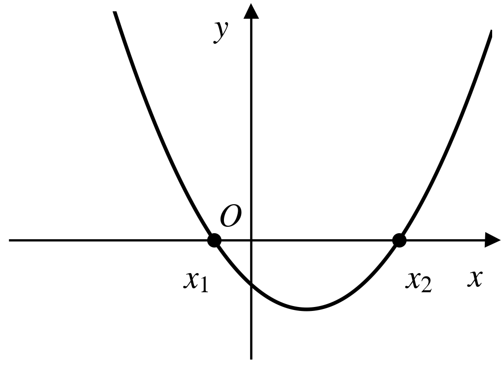{width="150"} 与 $x$ 轴有两个交点 | 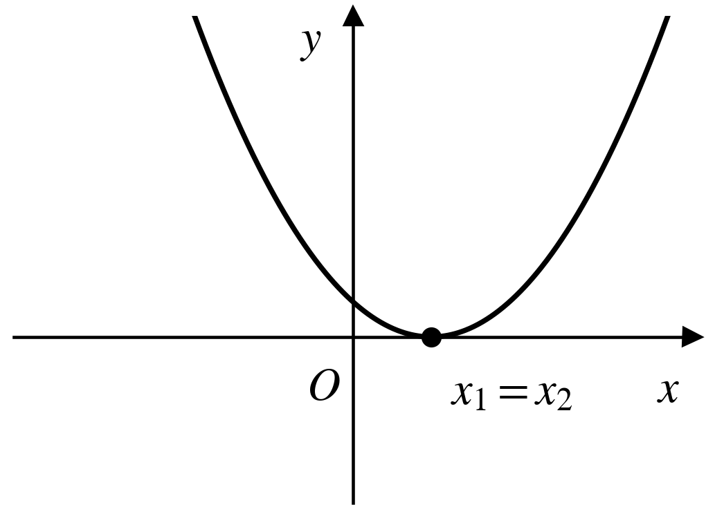{width="150"} 与 $x$ 轴有一个切点 | 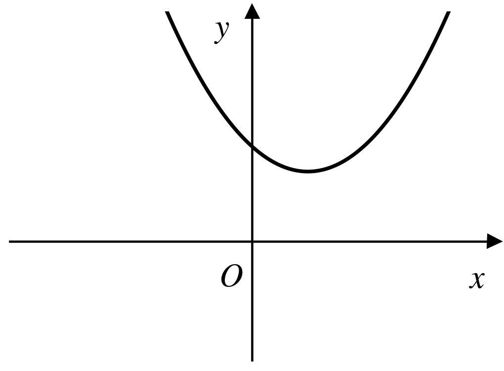{width="150"} 与 $x$ 轴无交点 |
| 一元二次方程 $ax^2 + bx + c = 0\ (a > 0)$ 的根 | 有两个不相等的实数根 | 有两个相等的实数根 | 没有实数根 |
| $ax^2 + bx + c > 0\ (a > 0)$ 的解集 | $\{x \mid x < x_1 \text{ 或 } x > x_2\}$ | $\left\{x \mid x \neq -\dfrac{b}{2a}\right\}$ | $\mathbb{R}$ |
| $ax^2 + bx + c < 0\ (a > 0)$ 的解集 | $\{x \mid x_1 < x < x_2\}$ | $\varnothing$ | $\varnothing$ |

## 二、解不等式

### 分式不等式

**定义：** 形如 $\dfrac{f(x)}{\varphi(x)} > 0$ 或 $\dfrac{f(x)}{\varphi(x)} < 0$（其中 $f(x)$、$\varphi(x)$ 为整式且 $\varphi(x) \neq 0$）的不等式称为分式不等式。

**一般解法：**

1. 化分式不等式一边为零；
2. 应用"同号相乘（除）得正，异号相乘（除）得负"，转化为同解不等式组解之；
3. 解分式不等式的基本思路是将其转化为整式不等式，在此过程中，变形的等价性尤为重要；
4. 形如 $\dfrac{ax+b}{cx+d} > 0$ 的分式不等式（其中 $a, c \neq 0$）可直接转化为同解的一元二次不等式 $(ax+b)(cx+d) > 0$ 求解。须注意，分式不等式 $\dfrac{ax+b}{cx+d} \geq 0\ (a, c \neq 0)$ 与下面的不等式组同解：

$$
\begin{cases}
(ax+b)(cx+d) \geq 0, \\
cx+d \neq 0
\end{cases}
$$

!!! note "知识补充"

    ① 解分式不等式一般不先直接去分母，而是先移项、通分化成形如 $\dfrac{f(x)}{g(x)} > 0$ 或 $\dfrac{f(x)}{g(x)} \geq 0$ 的形式，再进行同解变形。有

    $$
    \frac{f(x)}{g(x)} > 0 \Leftrightarrow f(x)g(x) > 0
    $$

    $$
    \frac{f(x)}{g(x)} \geq 0 \Leftrightarrow \begin{cases} f(x)g(x) \geq 0 \\ g(x) \neq 0 \end{cases} \Leftrightarrow f(x)g(x) > 0 \text{ 或 } f(x) = 0
    $$

    ② 解分式不等式时，切忌随意去分母。正确的解法是通过讨论决定分母的正负号，利用不等式的基本性质将原不等式化为几个不等式组；或先通过移项将不等式的一边变为零，再通分找到原不等式的等价不等式（组）。

### 一元高次不等式：穿针引线

**解题步骤：**

① 分解成若干个一次因式的积，并使每一个因式中最高次项的系数为正；

② 将每一个一次因式的根标在数轴上，从最大根的右上方依次通过每一点画曲线，并注意**奇穿偶不穿**；

③ 根据曲线显现出的 $f(x)$ 的符号变化规律，写出不等式的解集。

例如 $a_1 < a_2 < a_3 < \cdots < a_n$，则不等式 $(x-a_1)(x-a_2)\cdots(x-a_n) > 0$ 或 $(x-a_1)(x-a_2)\cdots(x-a_n) < 0$ 的解法如下图所示（即"穿针引线"或"数轴标根法"）：

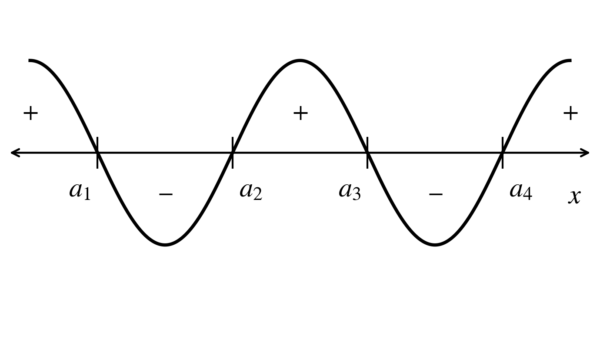{width="520"}

*图：从最大根的右上方起笔，依次穿过各根（奇次根穿过数轴，偶次根不穿过数轴）*

!!! warning "说明"

    穿针引线主要用于简单的一元高次不等式题型。上海高考不作要求，可以简单了解；但在平时的数学练习中，利用该方法可以很快地解决很多题目，建议掌握。

### 含绝对值的不等式

**1. 最简单的绝对值不等式的同解变形**

$$
\begin{aligned}
&|x| < a \Leftrightarrow -a < x < a; \quad |ax+b| < c \Leftrightarrow -c < ax+b < c; \\
&|x| > a \Leftrightarrow x < -a \text{ 或 } x > a; \quad |ax+b| > c \Leftrightarrow ax+b < -c \text{ 或 } ax+b > c; \\
&a < |x| < b \Leftrightarrow a < x < b \text{ 或 } -b < x < -a \quad (a, b \text{ 为正数}).
\end{aligned}
$$

**2. 绝对值不等式的常见类型的同解变形**

$$
|f(x)| < g(x) \Leftrightarrow \begin{cases} g(x) > 0 \\ -g(x) < f(x) < g(x) \end{cases}
$$

$$
|f(x)| > g(x) \Leftrightarrow g(x) \leq 0\ (f(x),\ g(x) \text{ 不同时为 } 0) \text{ 或 } \begin{cases} g(x) > 0 \\ f(x) < -g(x) \text{ 或 } f(x) > g(x) \end{cases}
$$

$$
|f(x)| \leq |g(x)| \Leftrightarrow f^2(x) \leq g^2(x)
$$

**3. 绝对值的几何意义：** 它表示实数 $x$ 在数轴上所对应的点到原点的距离。因此，求不等式 $|x| < a\ (a > 0)$ 的解集，就是求数轴上到原点的距离小于 $a$ 的点对应的实数 $x$ 的集合。

所以，不等式 $|x| < a\ (a > 0)$ 的解集为 $(-a, a)$（如图(1)）。类似地，不等式 $|x| > a\ (a > 0)$ 的解集为 $(-\infty, -a) \cup (a, +\infty)$（如图(2)）。

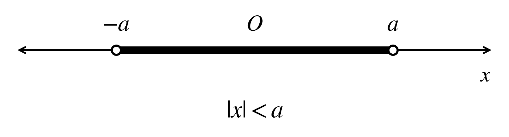{width="480"}

*图(1)：$|x| < a$ 的解集为 $(-a, a)$*

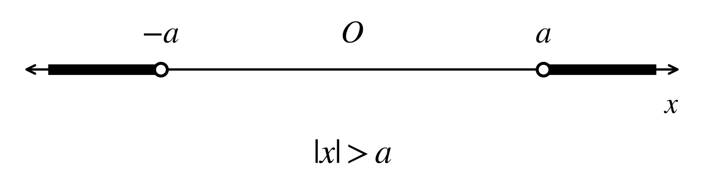{width="480"}

*图(2)：$|x| > a$ 的解集为 $(-\infty, -a) \cup (a, +\infty)$*

解绝对值不等式的核心为：**去绝对值**。

### 无理不等式

**定义：** 若不等式的不等号两边都是代数式，并且其中至少有一个是代数无理式，则称这样的不等式为无理不等式（irrational inequality），或根式不等式。无理不等式常常转化为等价的有理不等式（组）来求解。

**常见类型：**

① $\sqrt{f(x)} > \sqrt{g(x)} \Leftrightarrow \begin{cases} f(x) \geq 0 \\ g(x) \geq 0 \\ f(x) > g(x) \end{cases}$

② $\sqrt{f(x)} > g(x) \Leftrightarrow \begin{cases} f(x) \geq 0 \\ g(x) \geq 0 \\ f(x) > [g(x)]^2 \end{cases}$ 或 $\begin{cases} f(x) \geq 0 \\ g(x) < 0 \end{cases}$

③ $\sqrt{f(x)} < g(x) \Leftrightarrow \begin{cases} f(x) \geq 0 \\ g(x) > 0 \\ f(x) < [g(x)]^2 \end{cases}$

④ $\sqrt{f(x) \cdot g(x)} \geq 0 \Leftrightarrow \begin{cases} f(x) \geq 0 \\ g(x) \geq 0 \end{cases}$ 或 $f(x) = 0$

### 例题

**例 1.** 解不等式：

$$
\frac{x^2 - 9x + 11}{x^2 - 2x + 1} \geq 7
$$

## 三、基本不等式

高考不仅要求会解简单的不等式，还要求能够使用一些常用的不等式来求式子的最值。课本上仅列出两种需要掌握的不等式：均值不等式和绝对值不等式。

### 二元均值不等式

对于正实数 $a$、$b$（其实可以为 $0$），有

$$
\frac{a+b}{2} \geq \sqrt{ab}
$$

其中左侧称为 $a$ 与 $b$ 的算术平均数，右侧称为 $a$ 与 $b$ 的几何平均数，该式即所谓的"二元均值不等式"。移项配方即可证明，取等当且仅当 $a = b$。

除此之外，还有很多常用变式。对于实数 $a$、$b$ 有（这里没有正实数的要求）：

$$
a^2 + b^2 \geq \frac{1}{2}(a+b)^2 \geq 2ab
$$

$$
\left(\frac{a+b}{2}\right)^2 \geq ab
$$

我们有如下不等式链，即对于正实数 $a$、$b$ 有：

$$
\sqrt{\frac{a^2+b^2}{2}} \geq \frac{a+b}{2} \geq \sqrt{ab} \geq \frac{2}{\frac{1}{a}+\frac{1}{b}}
$$

且取等条件均是 $a = b$，同学们可以将它的证明当作习题。

### 三角不等式（绝对值不等式）

教材上称之为"三角不等式"，即初中平面几何里学过的"两点之间线段最短"，或是"$AB + BC \geq AC$"等，这些说的都是同一个意思。但由于不等式章节的讨论对象只是实数轴上的点，而不是平面里的点，命名为"三角不等式"是令人费解的——实数轴上哪来的三角形？这个命名要在后续向量、复数章节才合理，彼时也不叫绝对值了，而称"模"。

对于实数 $a$、$b$，有：

$$
|a+b| \leq |a| + |b|
$$

取等当且仅当 $ab \geq 0$（同号或有 $0$，即无异号）。比较简单的证明是平方法。

**证明：** 原不等式两端均非负，因此等价于两端平方（一般不等式并不等价于两端平方）。

$$
|a+b|^2 \leq (|a|+|b|)^2
$$

$$
a^2 + 2ab + b^2 \leq |a|^2 + 2|a||b| + |b|^2
$$

$$
ab \leq |ab|
$$

成立，且取等条件为 $ab \geq 0$（同号或有 $0$，即无异号）。

绝对值不等式也有诸多变式，复习过程中需注意它们各自的取等条件：

$$
|a-b| \leq |a| + |b|
$$

$$
\big||a| - |b|\big| \leq |a+b|
$$

这两个变式与绝对值不等式可以统一起来写成：

$$
\big||a| - |b|\big| \leq |a \pm b| \leq |a| + |b|
$$

还有变式：

$$
|a-b| + |b-c| \geq |a-c|
$$

## 四、不等式的应用

不等式的应用就是运用所学的平均值不等式和三角不等式去解决数学问题和实际问题。相对来讲，平均值不等式用得更频繁。在运用平均值不等式时，要注意其本身的限制：正实数，并且最后要计算取等条件并验证；在运用三角不等式时，要意识到一定有一个不等号实际上是等号。

不等式和函数也有着紧密的联系，它在求函数的定义域、值域、单调性等方面都有重要的地位。对于平均值不等式而言，要注意它和对勾函数 $y = ax + \dfrac{b}{x}\ (a > 0,\ b > 0)$ 的联系；对于三角不等式而言，要联系它的几何意义。

解决实际问题时，要理清函数关系，建立数学模型，之后一定要确认函数的定义域，再去研究函数的不等关系，并判断取等条件是否在定义域内，最后给出结论。

## 五、函数的概念

### 函数与三要素

一般地，设 $A$、$B$ 是非空的实数集，如果对于集合 $A$ 中的**任意**一个数 $x$，按照某种确定的对应关系 $f$，在集合 $B$ 中都有**唯一**确定的数 $y$ 和它**对应**，那么就称 $f\colon A \to B$ 为从集合 $A$ 到集合 $B$ 的一个函数。

**函数三要素：** 定义域、对应关系、值域。

- **定义域：** $x$ 的取值范围 $A$ 叫做函数 $y = f(x)$ 的定义域。
- **值域：** 函数值的集合 $\{f(x) \mid x \in A\}$。

**提醒：** 判断两个函数是不是同一个函数，只要看定义域与对应关系是否完全相同即可。

**函数表示方法：** 解析法、图象法、列表法。

### 复合函数

**定义：** 如果函数 $y = f(x)$ 的定义域为 $A$，函数 $t = g(x)$ 的定义域为 $D$，值域为 $C$，则当 $C \subseteq A$ 时，称函数 $y = f(g(x))$ 为 $f(x)$ 与 $g(x)$ 在 $D$ 上的复合函数，其中 $t$ 叫做中间变量，$t = g(x)$ 叫作内层函数，$y = f(x)$ 叫作外层函数。

**几点提醒：**

① 函数 $f(x)$ 的定义域是指 $x$ 的取值范围。

② 函数 $f(g(x))$ 的定义域是指 $x$ 的取值范围，而不是 $g(x)$ 的取值范围。

③ 已知 $f(x)$ 的定义域为 $A$，求 $f(g(x))$ 的定义域，其实质是已知 $g(x)$ 的取值范围为 $A$，求出 $x$ 的取值范围。

④ 已知 $f(g(x))$ 的定义域为 $B$，求 $f(x)$ 的定义域，其实质是已知 $f(g(x))$ 中 $x$ 的取值范围 $B$，求 $g(x)$ 的取值范围，此范围即是指 $f(x)$ 的定义域。

### 分段函数

(1) 若函数在其定义域的不同子集上，因对应关系不同而分别用几个不同的式子来表示，这种函数称为分段函数。

(2) 分段函数表示的是一个函数。分段函数的定义域等于各段函数的定义域的**并集**，其值域等于各段函数的值域的**并集**。

### 定义域的求法

**基本函数的定义域限制：**

① 分式的分母不为零；

② 偶次方根的被开方数大于或等于零；

③ 对数的真数大于零，底数大于零且不等于 $1$；

④ 零次幂或负指数次幂的底数不为零；

⑤ 三角函数中的正切 $y = \tan x$ 的定义域是 $\left\{x \mid x \in \mathbb{R},\ \text{且}\ x \neq k\pi + \dfrac{\pi}{2},\ k \in \mathbb{Z}\right\}$；

⑥ 已知 $f(x)$ 的定义域求 $f[g(x)]$ 的定义域，或已知 $f[g(x)]$ 的定义域求 $f(x)$ 的定义域，遵循两点：

　　Ⅰ 定义域是指自变量的取值范围；

　　Ⅱ 在对应法则下，括号内式子的范围相同；

⑦ 对于实际问题中函数的定义域，还需根据实际意义再限制，从而得到实际问题函数的定义域。

### 解析式的求法

① **待定系数法：** 若已知函数的类型（如一次函数、二次函数等），则可用待定系数法。

② **换元法：** 主要适用于求解已知 $f(g(x))$ 的解析式。

③ **配凑法：** 由已知条件 $f(g(x)) = F(x)$，可将 $F(x)$ 改写成关于 $g(x)$ 的表达式，然后以 $x$ 替代 $g(x)$，便得 $f(x)$ 的解析式。

④ **方程组法：** 主要适用于已知 $f(x)$ 与 $f(-x)$、$f\left(\dfrac{1}{x}\right)$、$f\left(-\dfrac{1}{x}\right)$ 等之间的关系，求 $f(x)$ 解析式。

⑤ **赋值法：** $f(x)$ 是关于 $x$、$y$ 两个变量的方程式，可对变量赋值求出 $f(x)$。

### 值域的求法

① **观察法：** 根据最基本函数的值域（如 $x^2 \geq 0$，$a^x > 0$）及函数的图像、性质、简单的计算、推理，凭观察能直接得到一些简单的复合函数的值域。

② **配方法：** 对于形如 $y = ax^2 + bx + c\ (a \neq 0)$ 的值域问题，可充分利用二次函数可配方的特点，结合二次函数的定义域求出函数的值域。

③ **图像法：** 根据所给数学式子的特征，构造合适的几何模型。

④ **基本不等式法：** 注意使用基本不等式的条件，即一正、二定、三相等。

⑤ **换元法：** 分为三角换元法与代数换元法。对于形如 $y = ax + b + \sqrt{cx + d}$ 的值域，可通过换元将原函数转化为二次型函数。

⑥ **分离常数法：** 对某些齐次分式型的函数进行常数化处理，使函数解析式简化以便于分析。

⑦ **判别式法：** 把函数解析式化为关于 $x$ 的一元二次方程，利用一元二次方程的判别式求值域。一般地，形如 $y = \dfrac{ax^2 + bx + c}{dx^2 + ex + f}$ 的函数值域问题可运用判别式法（注意 $x$ 的取值范围必须为实数集 $\mathbb{R}$）。

⑧ **单调性法：** 先确定函数在定义域（或它的子集）内的单调性，再求出值域。

⑨ **有界性法：** 充分利用三角函数或一些代数表达式的有界性，求出值域。因为常出现反解出 $y$ 的表达式的过程，故又常称此为反解有界性法。

⑩ **导数法：** 先利用导数求出函数的极大值和极小值，再确定最大（小）值，从而求出函数的值域。

## 六、函数的单调性与最值

### 单调性的定义

| 增函数 | 减函数 |
|:------|:------|
| 设函数 $f(x)$ 的定义域为 $D$，区间 $I \subseteq D$，$\forall x_1, x_2 \in I$，当 $x_1 < x_2$ 时，都有 $f(x_1) \leq f(x_2)$，那么就称函数 $f(x)$ 在区间 $I$ 上**单调递增**（特别地，若总有 $f(x_1) < f(x_2)$，则称 $f(x)$ 在 $I$ 上严格增） | 当 $x_1 < x_2$ 时，都有 $f(x_1) \geq f(x_2)$，那么就称函数 $f(x)$ 在区间 $I$ 上**单调递减**（特别地，若总有 $f(x_1) > f(x_2)$，则称 $f(x)$ 在 $I$ 上严格减） |

**单调性：** "严格增""严格减""增"及"减"统称为函数的单调性。

!!! note "注意"

    1. 函数的单调区间是函数定义域的子集，在讨论函数的单调区间的同时不能忽略函数定义域的要求。
    2. 有多个单调区间时，不同单调区间之间不能用"$\cup$"连接，可以用"和""与"及"逗号"连接。若用"$\cup$"连接的区间上函数单调，则需符合图像自左向右的高低统一性及自变量与函数值的一一对应效果。

### 函数的最值

设函数 $y = f(x)$ 的定义域为 $D$，如果存在实数 $M$ 满足：

| 条件 | 结论 |
|:-----|:-----|
| 对于任意的 $x \in D$，都有 $f(x) \leq M$；存在 $x_0 \in D$，使得 $f(x_0) = M$ | $M$ 为 $y = f(x)$ 的**最大值** |
| 对于任意的 $x \in D$，都有 $f(x) \geq M$；存在 $x_0 \in D$，使得 $f(x_0) = M$ | $M$ 为 $y = f(x)$ 的**最小值** |

**注意：**

1. 闭区间上的连续函数一定存在最大值、最小值。
2. 开区间上的"单峰"连续函数必存在最大值、最小值。

### 判断单调性的常用方法

**(1) 定义法：** 注意，高考中对函数单调性的证明，只能使用定义法。

**(2) 图象法：** 若函数是以图象形式给出的，或者函数的图象可作出，可由图象的升、降写出它的单调性（区间）。

**(3) 复合函数法：** 适用于形如 $y = f[g(x)]$ 的复合函数，利用"同增异减"，具体规则如下表：

| 函数 | 增减情况 | | | |
|:-----|:---:|:---:|:---:|:---:|
| 内函数 $u = g(x)$ | 增 | 增 | 减 | 减 |
| 外函数 $y = f(u)$ | 增 | 减 | 增 | 减 |
| $y = f[g(x)]$ | 增 | 减 | 减 | 增 |

**(4) 利用性质：** 利用基本初等函数的和、差构成的函数，根据各基本初等函数的增减性及"增 $+$ 增 $=$ 增，增 $-$ 减 $=$ 增，减 $+$ 减 $=$ 减，减 $-$ 增 $=$ 减"来判断。

**(5) 函数单调性的其他等价形式和结论：**

① $(x_1 - x_2)\left[f(x_1) - f(x_2)\right] > 0 \Leftrightarrow \dfrac{f(x_1) - f(x_2)}{x_1 - x_2} > 0 \Leftrightarrow$ 函数 $f(x)$ 为严格增函数。

② $(x_1 - x_2)\left[f(x_1) - f(x_2)\right] < 0 \Leftrightarrow \dfrac{f(x_1) - f(x_2)}{x_1 - x_2} < 0 \Leftrightarrow$ 函数 $f(x)$ 为严格减函数。

③ $f(x)$ 为严格增函数，则 $-f(x)$ 为严格减函数；$f(x)$ 为严格减函数，则 $-f(x)$ 为严格增函数。

④ 在公共定义域内，函数 $y = f(x)$ 与 $y = \dfrac{1}{f(x)}$ 的单调性相反。

⑤ $f(x)$、$g(x)$ 同为正值，且 $f(x)$、$g(x)$ 均为严格增函数，则 $f(x)g(x)$ 为严格增函数；$f(x)$、$g(x)$ 同为负值，且 $f(x)$、$g(x)$ 均为严格增函数，则 $f(x)g(x)$ 为严格减函数。

⑥ 已知 $F(x) = f(x) + g(x)$，定义域为 $D$，且 $x_1$、$x_2 \in D$，则

- $\left|g(x_1) - g(x_2)\right| > \left|f(x_1) - f(x_2)\right|$ 且 $g(x)$ 为增函数 $\Leftrightarrow F(x)$ 为增函数；
- $\left|g(x_1) - g(x_2)\right| > \left|f(x_1) - f(x_2)\right|$ 且 $g(x)$ 为减函数 $\Leftrightarrow F(x)$ 为减函数。

**(6) 导数法：**

① 若 $f(x)$ 在某个区间上单调递增，则在该区间上有 $f'(x) \geq 0$ 恒成立（但不恒等于 $0$）；反之，要满足 $f'(x) > 0$，才能得出 $f(x)$ 在某个区间上单调递增。

② 若 $f(x)$ 在某个区间上单调递减，则在该区间上有 $f'(x) \leq 0$ 恒成立（但不恒等于 $0$）；反之，要满足 $f'(x) < 0$，才能得出 $f(x)$ 在某个区间上单调递减。

### 函数图象的变换

**平移变换**（口诀："左加右减""上加下减"）：

| 变换 | 结果 |
|:-----|:-----|
| $y = f(x)$ 左移 $a\,(a > 0)$ 个单位 | $y = f(x + a)$ |
| $y = f(x)$ 右移 $a\,(a > 0)$ 个单位 | $y = f(x - a)$ |
| $y = f(x)$ 上移 $k\,(k > 0)$ 个单位 | $y = f(x) + k$ |
| $y = f(x)$ 下移 $k\,(k > 0)$ 个单位 | $y = f(x) - k$ |

**对称变换：**

| 原图象 | 变换 | 得到的图象 |
|:-----|:-----|:-----|
| $y = f(x)$ | 关于 $x$ 轴对称 | $y = -f(x)$ |
| $y = f(x)$ | 关于 $y$ 轴对称 | $y = f(-x)$ |
| $y = f(x)$ | 关于原点对称 | $y = -f(-x)$ |
| $y = a^x\ (a > 0,\ a \neq 1)$ | 关于直线 $y = x$ 对称 | $y = \log_a x\ (a > 0,\ a \neq 1)$ |

**伸缩变换：**

| 原图象 | 变换 | 得到的图象 |
|:-----|:-----|:-----|
| $y = f(x)$ | 纵坐标不变，各点横坐标变为原来的 $\dfrac{1}{a}\,(a > 0)$ 倍 | $y = f(ax)$ |
| $y = f(x)$ | 横坐标不变，各点纵坐标变为原来的 $A\,(A > 0)$ 倍 | $y = Af(x)$ |

**翻折变换（绝对值变换）：**

| 原图象 | 变换 | 得到的图象 |
|:-----|:-----|:-----|
| $y = f(x)$ | 留上翻下 | $y = \left\lvert f(x) \right\rvert$ |

口诀：以 $x$ 轴为界，保留 $x$ 轴上方的图象；将 $x$ 轴下方的图象翻折到 $x$ 轴上方。

| 原图象 | 变换 | 得到的图象 |
|:-----|:-----|:-----|
| $y = f(x)$ | 去左留右、右翻左 | $y = f\left(\left\lvert x \right\rvert\right)$ |

口诀：以 $y$ 轴为界，去掉 $y$ 轴左侧的图象，保留 $y$ 轴右侧的图象，再将 $y$ 轴右侧的图象翻折到 $y$ 轴左侧；本质是一个偶函数。

## 七、函数的奇偶性、对称性与周期性

### 奇偶性

| 类别 | 定义 | 图像特征 |
|:---|:---|:---|
| 奇函数 | 设函数 $f(x)$ 的定义域为 $D$，如果 $\forall x \in D$，都有 $-x \in D$，且 $f(-x)=-f(x)$ | 关于原点对称 |
| 偶函数 | 设函数 $f(x)$ 的定义域为 $D$，如果 $\forall x \in D$，都有 $-x \in D$，且 $f(-x)=f(x)$ | 关于 $y$ 轴对称 |

**奇偶性的性质：**

1. 函数的定义域关于原点对称是函数具有奇偶性的前提条件。

2. 若 $f(x) \ne 0$，则奇（偶）函数定义的等价形式如下：$f(x)$ 为奇函数 $\Leftrightarrow f(-x)=-f(x) \Leftrightarrow f(-x)+f(x)=0 \Leftrightarrow \dfrac{f(-x)}{f(x)}=-1$；$f(x)$ 为偶函数 $\Leftrightarrow f(-x)=f(x) \Leftrightarrow f(-x)-f(x)=0 \Leftrightarrow \dfrac{f(-x)}{f(x)}=1$。

3. 如果奇函数 $f(x)$ 在 $x=0$ 处有定义，那么一定有 $f(0)=0$。

4. 如果函数 $f(x)$ 是偶函数，那么 $f(x)=f(\lvert x\rvert)$。

5. 奇函数在关于原点对称的区间上具有相同的单调性；偶函数在关于原点对称的区间上具有相反的单调性。

6. 若 $y=f(x+a)$ 是奇函数，则 $f(-x+a)=-f(x+a)$；若 $y=f(x+a)$ 是偶函数，则 $f(-x+a)=f(x+a)$。

7. 运算函数的奇偶性规律：奇 $\pm$ 奇 $=$ 奇；偶 $\pm$ 偶 $=$ 偶；奇 $\pm$ 偶 $=$ 非奇非偶；奇 $\times(\div)$ 奇 $=$ 偶；奇 $\times(\div)$ 偶 $=$ 奇；偶 $\times(\div)$ 偶 $=$ 偶。

8. 复合函数 $y=f[g(x)]$ 的奇偶性原则：内偶则偶，内奇同外。

9. 常见奇偶性函数模型：

   **奇函数：**

   ① $f(x)=\dfrac{m(a^x+1)}{a^x-1}\ (x \ne 0)$ 或 $f(x)=\dfrac{m(a^x-1)}{a^x+1}$；

   ② $f(x)=\pm(a^x-a^{-x})$；

   ③ $f(x)=\log_a\dfrac{x+m}{x-m}=\log_a\left(1+\dfrac{2m}{x-m}\right)$ 或 $f(x)=\log_a\dfrac{x-m}{x+m}=\log_a\left(1-\dfrac{2m}{x+m}\right)$；

   ④ $f(x)=\log_a\left(\sqrt{x^2+1}+x\right)$ 或 $f(x)=\log_a\left(\sqrt{x^2+1}-x\right)$。

   **注：** 关于①式，也可以写成函数 $f(x)=m+\dfrac{2m}{a^x-1}\ (x \ne 0)$ 或 $f(x)=m-\dfrac{2m}{a^x+1}\ (m \in \mathbb{R})$。

   **偶函数：**

   ① $f(x)=\pm(a^x+a^{-x})$；

   ② $f(x)=\log_a\left(a^{mx}+1\right)-\dfrac{mx}{2}$；

   ③ $f(\lvert x\rvert)$ 类型的一切函数；

   ④ 常数函数。

### 周期性

**周期函数：** 对于函数 $y=f(x)$，如果存在一个非零常数 $T$，使得当 $x$ 取定义域内的任何值时，都有 $f(x+T)=f(x)$，那么就称函数 $y=f(x)$ 为周期函数，称 $T$ 为这个函数的周期。

**最小正周期：** 如果在周期函数 $f(x)$ 的所有周期中存在一个最小的正数，那么这个最小正数叫做 $f(x)$ 的最小正周期。

**有关周期的结论：**

(1) 若 $T$ 为 $f(x)$ 的周期，则 $kT\ (k \in \mathbb{N}^+)$ 也是 $f(x)$ 的周期（周期函数的定义域一定是无限集）；

(2) 若 $f(x)$ 的周期为 $T$，则 $y=f(ax+b)\ (a \ne 0)$ 是周期为 $\left\lvert\dfrac{T}{a}\right\rvert$ 的周期函数；

(3) 若 $u=g(x)$ 是周期函数，$f(u)$ 为任意函数，则 $f(g(x))$ 也是周期函数；

(4) 对于定义域内任意 $x$ 满足下列条件的 $f(x)$，均有 $T=2a$：

| 满足的条件 | 周期 |
|:---|:---:|
| ① $f(x+a)=f(x-a)$ | $T=2a$ |
| ② $f(x+a)=-f(x)$ | $T=2a$ |
| ③ $f(x+a)=\dfrac{1}{f(x)}$ | $T=2a$ |
| ④ $f(x+a)=-\dfrac{1}{f(x)}$ | $T=2a$ |
| ⑤ $f(x+a)=\dfrac{f(x)+1}{f(x)-1}$ | $T=2a$ |
| ⑥ $f(x+a)=\dfrac{1-f(x)}{1+f(x)}$ | $T=2a$ |

### 对称性

- $f(x)$ 关于点 $(a,\ b)$ 对称 $\Leftrightarrow f(x)+f(2a-x)=2b \Leftrightarrow y=f(x+a)-b$ 为奇函数；
- $f(x)$ 关于直线 $x=\dfrac{a+b}{2}$ 对称 $\Leftrightarrow f(a+x)=f(b-x)$。

**推论：**

① $y=f(x)$ 与 $y=2b-f(2a-x)$ 的图象关于点 $(a,\ b)$ 对称；

② $y=f(x)$ 与 $y=f(2a-x)$ 的图象关于直线 $x=a$ 对称。

**周期性与对称性的关系：**

① 若函数 $f(x)$ 的图象关于直线 $x=a$ 和 $x=b$ 对称，则 $T=2\lvert b-a\rvert\ (a \ne b)$ 为 $f(x)$ 的周期；

② 若函数 $f(x)$ 的图象关于点 $(a,\ 0)$ 和点 $(b,\ 0)$ 对称，则 $T=2\lvert b-a\rvert\ (a \ne b)$ 为 $f(x)$ 的周期；

③ 若函数 $f(x)$ 的图象关于直线 $x=a$ 和点 $(b,\ 0)$ 对称，则 $T=4\lvert b-a\rvert\ (a \ne b)$ 为 $f(x)$ 的周期。

### 原函数与导函数的性质关系

① 若函数 $f(x)$ 是奇函数，则函数 $f'(x)$ 是偶函数；

② 若函数 $f(x)$ 是偶函数，则函数 $f'(x)$ 是奇函数；

③ 若函数 $f'(x)$ 是奇函数，则函数 $f(x)$ 是偶函数；

④ 若函数 $f'(x)$ 是偶函数，则函数 $f(x)$ 不一定是奇函数，但函数 $f'(x)$ 的图象关于点 $(0,\ f(0))$ 对称；

⑤ 若函数 $f(x)$ 的图象关于直线 $x=a$ 对称，则函数 $f'(x)$ 的图象关于点 $(a,\ 0)$ 对称；

⑥ 若函数 $f(x)$ 的图象关于点 $(a,\ b)$ 对称，则函数 $f'(x)$ 的图象关于直线 $x=a$ 对称；

⑦ 若函数 $f'(x)$ 的图象关于直线 $x=a$ 对称，则函数 $f(x)$ 的图象关于点 $(a,\ f(a))$ 对称；

⑧ 若函数 $f'(x)$ 的图象关于点 $(a,\ b)$ 对称，则当 $b=0$ 时，函数 $f(x)$ 的图象关于直线 $x=a$ 对称；当 $b \ne 0$ 时，函数 $f(x)$ 的图象不关于直线 $x=a$ 对称；

⑨ 若函数 $f(x)$ 是周期函数，则函数 $f'(x)$ 也是周期函数；反之不成立。

## 八、幂函数与指数函数

### 根式与分数指数幂

| | 内容 |
|:---|:---|
| 概念 | 如果 $x^n = a$，那么 $x$ 叫做 $a$ 的 $n$ 次方根，其中 $n > 1$，$n \in \mathbb{N}^*$ |
| 性质 | 当 $n$ 是奇数时，$a$ 的 $n$ 次方根为 $x = \sqrt[n]{a}$ |
| | 当 $n$ 是偶数时，正数 $a$ 的 $n$ 次方根为 $x = \pm\sqrt[n]{a}$，负数没有偶次方根 |
| | $0$ 的任何次方根都是 $0$，记作 $\sqrt[n]{0} = 0$ |
| 概念 | 式子 $\sqrt[n]{a}$ 叫做根式，其中 $n$ 叫做根指数，$a$ 叫做被开方数 |
| 性质 | 当 $n$ 为奇数时，$\sqrt[n]{a^n} = a$ |
| | 当 $n$ 为偶数时，$\sqrt[n]{a^n} = \left\lvert a \right\rvert = \begin{cases} a, & a \geq 0, \\ -a, & a < 0 \end{cases}$ |

**分数指数幂及指数幂的运算性质：**

| 内容 | 条件 |
|:---|:---|
| 正分数指数幂：$a^{\frac{m}{n}} = \sqrt[n]{a^m}$ | $a > 0$，$m$、$n \in \mathbb{N}^*$，$n > 1$ |
| 负分数指数幂：$a^{-\frac{m}{n}} = \dfrac{1}{a^{\frac{m}{n}}} = \dfrac{1}{\sqrt[n]{a^m}}$ | |
| $0$ 的正分数指数幂等于 $0$，$0$ 的负分数指数幂没有意义 | |
| $a^r \cdot a^s = a^{r+s}$ | $a > 0$，$b > 0$，$r$、$s \in \mathbb{R}$ |
| $(a^r)^s = a^{rs}$ | |
| $(ab)^r = a^r b^r$ | |

### 幂函数

**概念：** 当指数 $a$ 固定，等式

$$
y = x^a
$$

确定了变量 $y$ 随变量 $x$ 变化的规律，称为指数为 $a$ 的幂函数。幂函数 $y = x^a$ 的指数 $a \in \mathbb{R}$，使得 $x^a$ 有意义的 $x$ 的取值范围称为幂函数的定义域。

**幂函数的特征：** ① $x^a$ 的系数为 $1$；② $x^a$ 的底数是自变量；③ 指数为常数。

**常见的幂函数图像及性质：**

| 函数 | $y = x$ | $y = x^2$ | $y = x^3$ | $y = x^{\frac{1}{2}}$ | $y = x^{-1}$ |
|:---|:---:|:---:|:---:|:---:|:---:|
| 图象 | 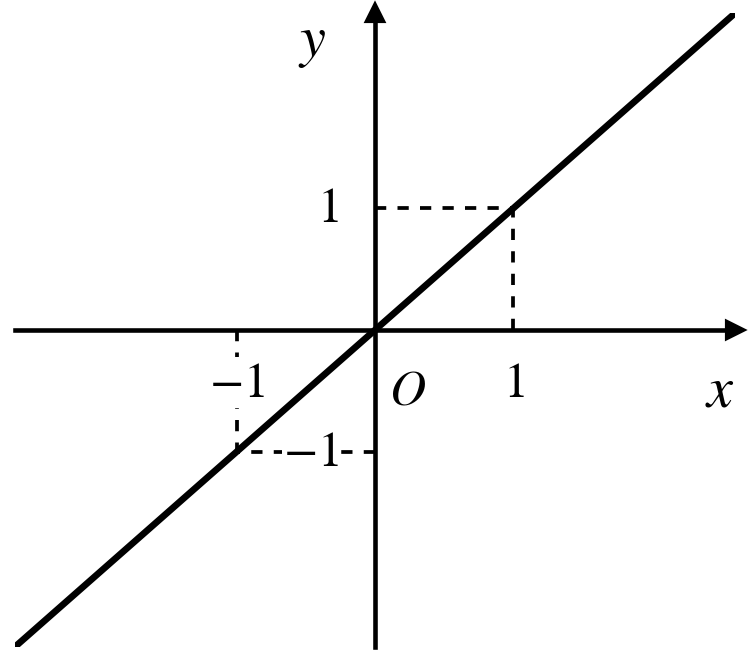{width="150"} | 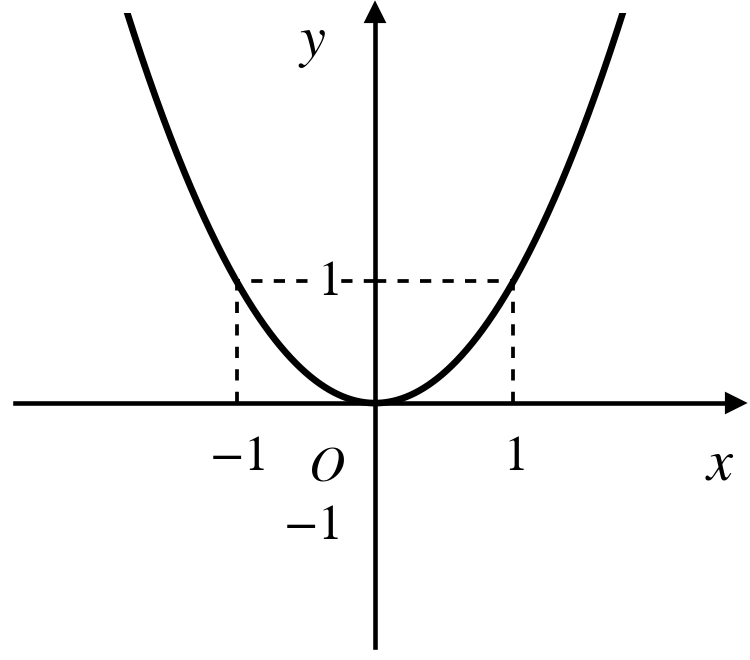{width="150"} | {width="150"} | 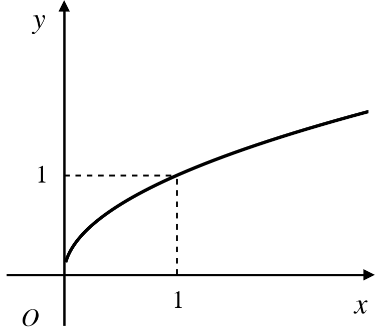{width="150"} | {width="150"} |
| 定义域 | $\mathbb{R}$ | $\mathbb{R}$ | $\mathbb{R}$ | $\{x \mid x \geq 0\}$ | $\{x \mid x \neq 0\}$ |
| 值域 | $\mathbb{R}$ | $\{y \mid y \geq 0\}$ | $\mathbb{R}$ | $\{y \mid y \geq 0\}$ | $\{y \mid y \neq 0\}$ |
| 奇偶性 | 奇 | 偶 | 奇 | 非奇非偶 | 奇 |
| 单调性 | 在 $\mathbb{R}$ 上单调递增 | 在 $(-\infty, 0)$ 上单调递减，在 $(0, +\infty)$ 上单调递增 | 在 $\mathbb{R}$ 上单调递增 | 在 $[0, +\infty)$ 上单调递增 | 在 $(-\infty, 0)$ 和 $(0, +\infty)$ 上单调递减 |
| 公共点 | $(1, 1)$ | $(1, 1)$ | $(1, 1)$ | $(1, 1)$ | $(1, 1)$ |

**幂函数的性质：**

(1) 幂函数 $y = x^a$ 的图象都过点 $(1, 1)$。

(2) 在 $(0, +\infty)$ 上，若 $a > 0$，$y = x^a$ 单调递增；若 $a < 0$，$y = x^a$ 单调递减，且以 $x$ 轴、$y$ 轴为渐近线；$0 < a < 1$ 时函数图像上凸，$a > 1$ 时函数图像下凸。

(3) $y = x$，$y = x^3$，$y = x^{\frac{1}{3}}$，$y = x^{-1}$，$y = x^{-3}$ 等是奇函数，图像关于原点对称。

$y = x^2$，$y = x^{-2}$，$y = x^{\frac{2}{3}}$，$y = x^{-\frac{2}{3}}$ 等是偶函数，图像关于 $y$ 轴对称。

(4) 当 $a$ 为奇数，$y = x^a$ 为奇函数；当 $a$ 为偶数，$y = x^a$ 为偶函数。当 $a = \dfrac{p}{q}$ 时（$p$、$q$ 互质），$p$ 为偶数时，$y = x^a$ 为偶函数。

**幂函数 $y = x^a\left(a = \dfrac{p}{q},\ p, q \in \mathbb{Z}\ \text{且不为}\ 0,\ p, q\ \text{不可约}\right)$ 的图象：**

1. 当 $a = 1$ 时，$y = x$ 的图象是一条直线。
2. 当 $a = 0$ 时，$y = x^0 = 1\ (x \neq 0)$ 的图象是一条不包含点 $(0, 1)$ 的直线。
3. 当 $a$ 为其他值时，相应幂函数的图象如下表：

| $a = \dfrac{p}{q}$ | $a < 0$ | $0 < a < 1$ | $a > 1$ |
|:---|:---:|:---:|:---:|
| $p, q$ 都是奇数 | 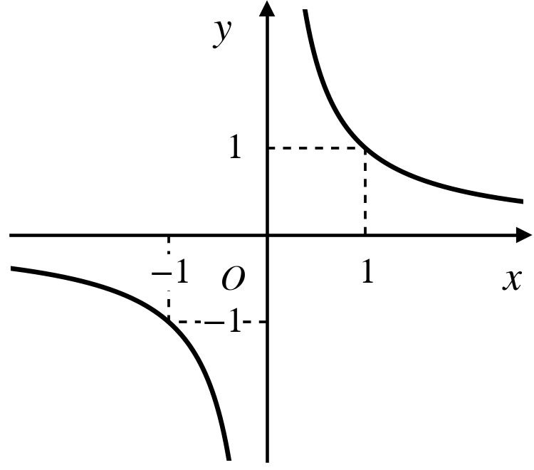{width="165"} | 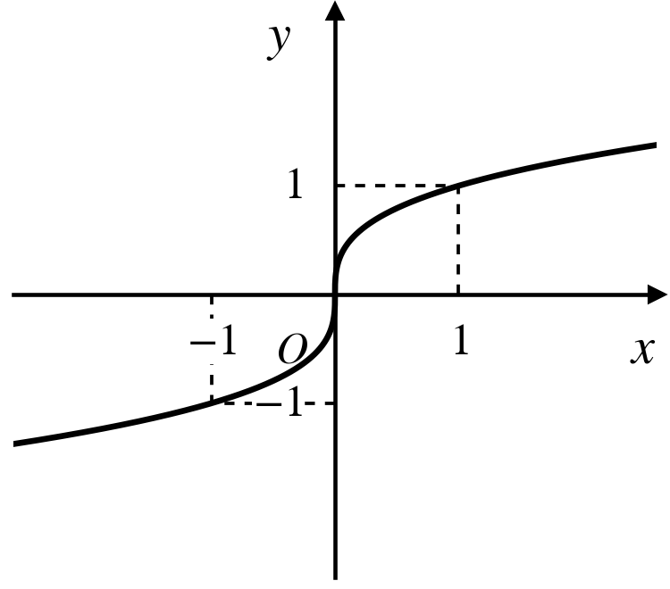{width="165"} | 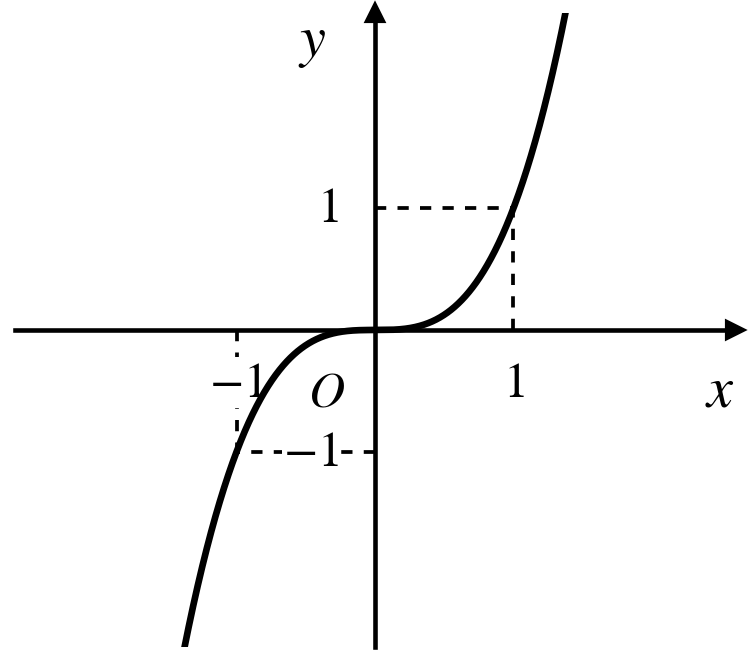{width="165"} |
| $p$ 为偶数，$q$ 为奇数 | 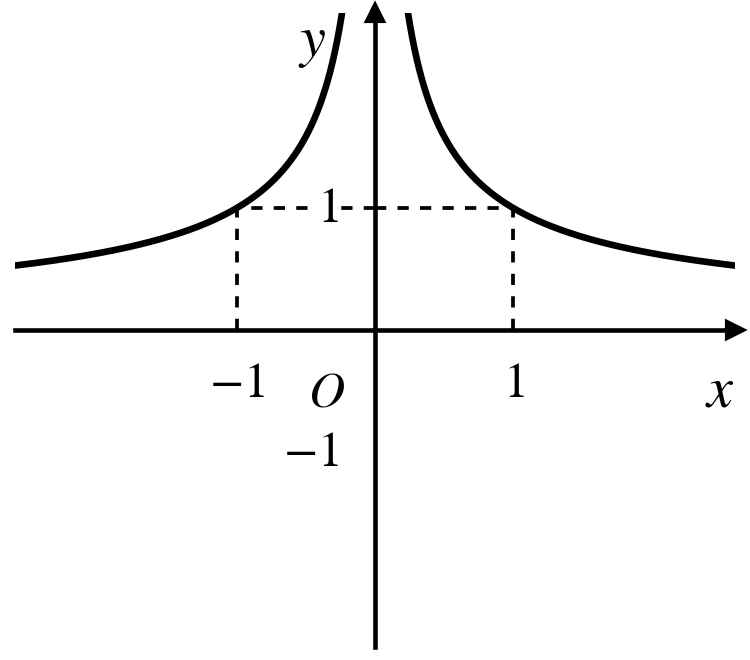{width="165"} | 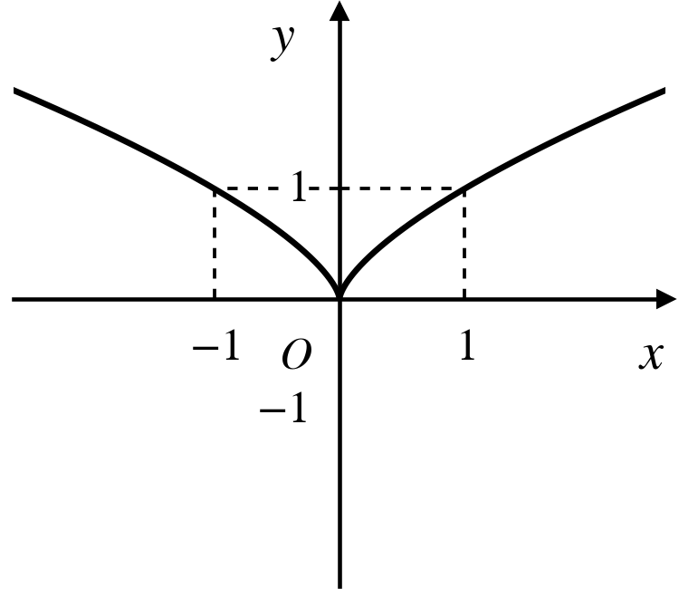{width="165"} | 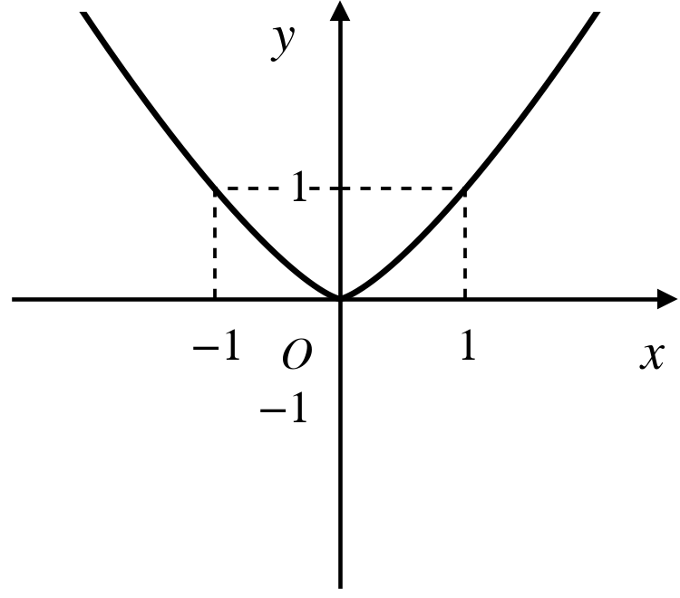{width="165"} |
| $p$ 为奇数，$q$ 为偶数 | 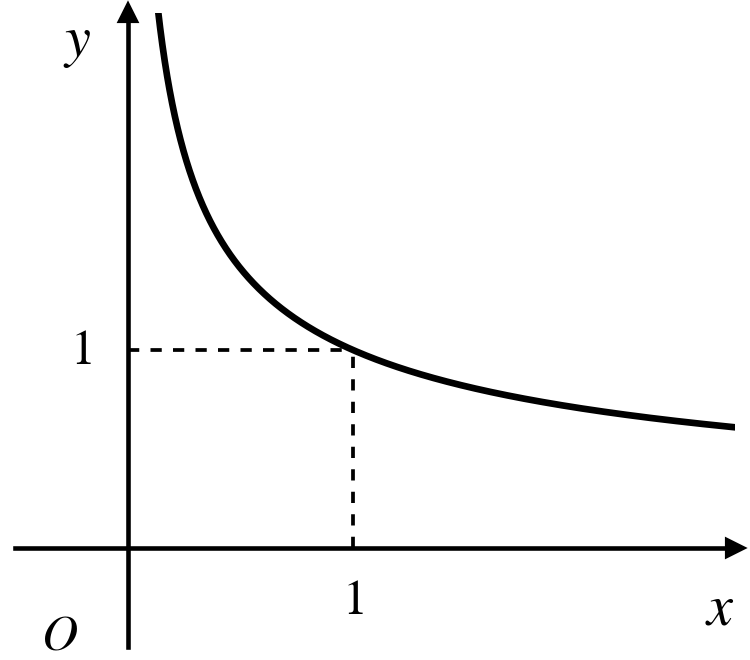{width="165"} | {width="165"} | 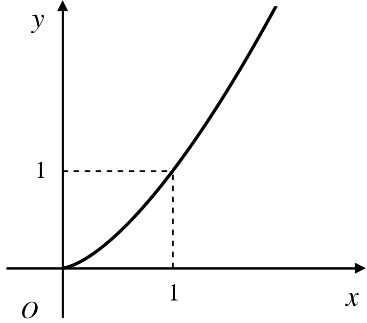{width="165"} |

### 指数函数

**概念：** 当底数 $a$ 固定，且 $a > 0$，$a \neq 1$ 时，等式

$$
y = a^x
$$

确定了变量 $y$ 随变量 $x$ 变化的规律，称为底为 $a$ 的指数函数。

**指数函数的图像与性质：**

| | $a > 1$ | $0 < a < 1$ |
|:---|:---|:---|
| 图象 | 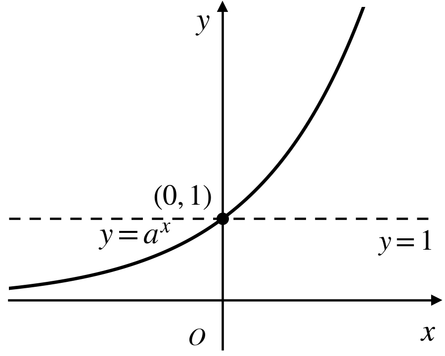{width="230"} | 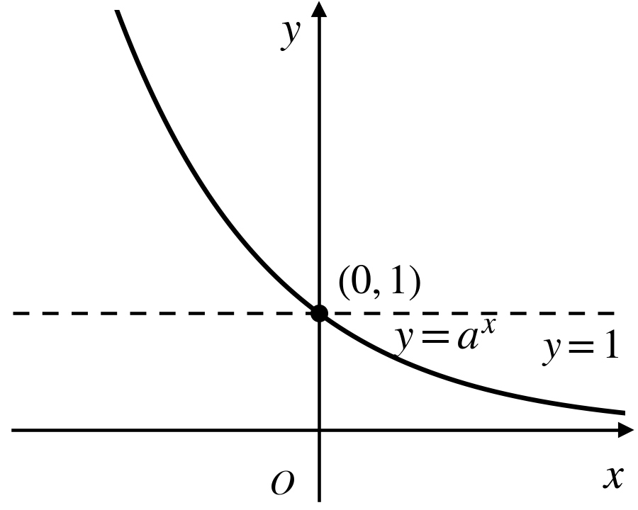{width="230"} |
| 定义域 | $\mathbb{R}$ | $\mathbb{R}$ |
| 值域 | $(0, +\infty)$ | $(0, +\infty)$ |
| 性质 | 过定点 $(0, 1)$，即当 $x = 0$ 时，$y = 1$ | 过定点 $(0, 1)$，即当 $x = 0$ 时，$y = 1$ |
| | 当 $x > 0$ 时，$y > 1$；当 $x < 0$ 时，$0 < y < 1$ | 当 $x < 0$ 时，$y > 1$；当 $x > 0$ 时，$0 < y < 1$ |
| | 在 $(-\infty, +\infty)$ 上是增函数 | 在 $(-\infty, +\infty)$ 上是减函数 |

**注意：**

1. 指数函数 $y = a^x\ (a > 0,\ \text{且}\ a \neq 1)$ 的图象恒过点 $(0, 1)$，$(1, a)$，$\left(-1, \dfrac{1}{a}\right)$，依据这三点的坐标可得到指数函数的大致图象。
2. 函数 $y = a^x$ 与 $y = \left(\dfrac{1}{a}\right)^x\ (a > 0,\ \text{且}\ a \neq 1)$ 的图象关于 $y$ 轴对称。
3. 在直线 $x = 1$ 的右侧，指数函数的图象越高，其底数的值越大。如图所示，其中 $0 < d < c < 1 < b < a$。

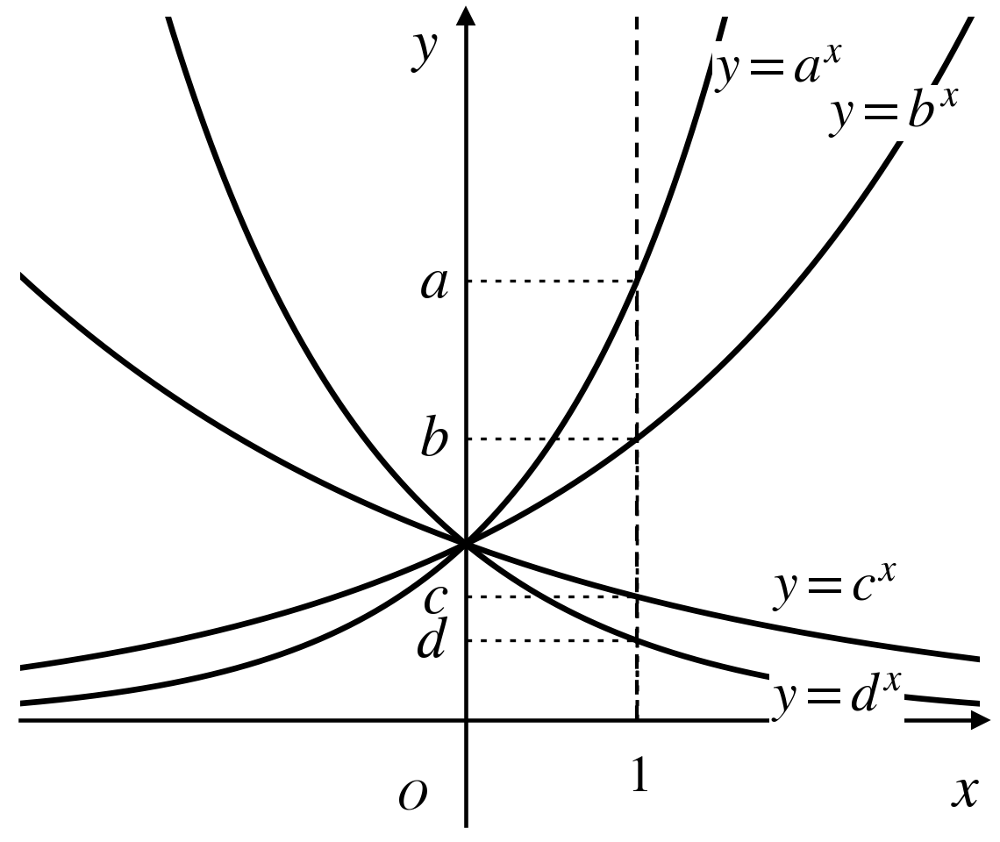{width="480"}

## 九、对数运算与对数函数

### 对数与对数运算

**对数概念：** 一般地，如果 $a^x = N\ (a > 0\ \text{且}\ a \neq 1)$，那么数 $x$ 叫做以 $a$ 为底 $N$ 的对数，记作

$$
x = \log_a N
$$

读作以 $a$ 为底 $N$ 的对数，其中 $a$ 叫做对数的底数，$N$ 叫做真数。

**常见对数：**

① 一般对数：以 $a\ (a > 0\ \text{且}\ a \neq 1)$ 为底，记为 $\log_a N$，读作以 $a$ 为底 $N$ 的对数；

② 常用对数：以 $10$ 为底，记为 $\lg N$；

③ 自然对数：以 $e$ 为底，记为 $\ln N$。

**对数的性质与运算法则**（其中 $a > 0$ 且 $a \neq 1$）：

① $\log_a 1 = 0$；$\log_a a = 1$；

② $a^{\log_a N} = N$（$N > 0$）；

③ 对数换底公式：$\log_a b = \dfrac{\log_c b}{\log_c a}$；

④ $\log_a (MN) = \log_a M + \log_a N$；

⑤ $\log_a \dfrac{M}{N} = \log_a M - \log_a N$；

⑥ $\log_{a^m} b^n = \dfrac{n}{m}\log_a b\ (m,\ n \in \mathbb{R})$；

⑦ $a^{\log_a b} = b$ 和 $\log_a a^b = b$；

⑧ $\log_a b = \dfrac{1}{\log_b a}$。

### 对数函数

**概念：** 当底数 $a$ 固定，且 $a > 0$，$a \neq 1$ 时，$x$ 以 $a$ 为底的对数

$$
y = \log_a x
$$

确定了变量 $y$ 随变量 $x$ 变化的规律，称为底为 $a$ 的对数函数。

**对数函数的 3 个特征：** (1) 底数 $a > 0$ 且 $a \neq 1$；(2) 自变量 $x > 0$；(3) 系数为 $1$。

**对数函数的图像与性质：**

| | $a > 1$ | $0 < a < 1$ |
|:---|:---|:---|
| 图象 | 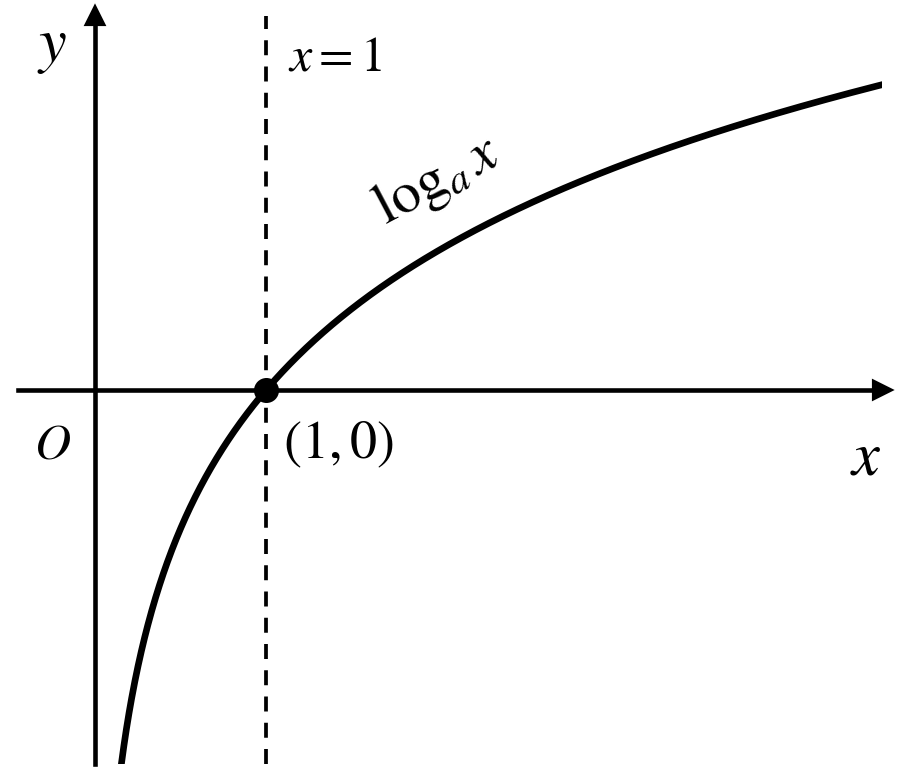{width="230"} | 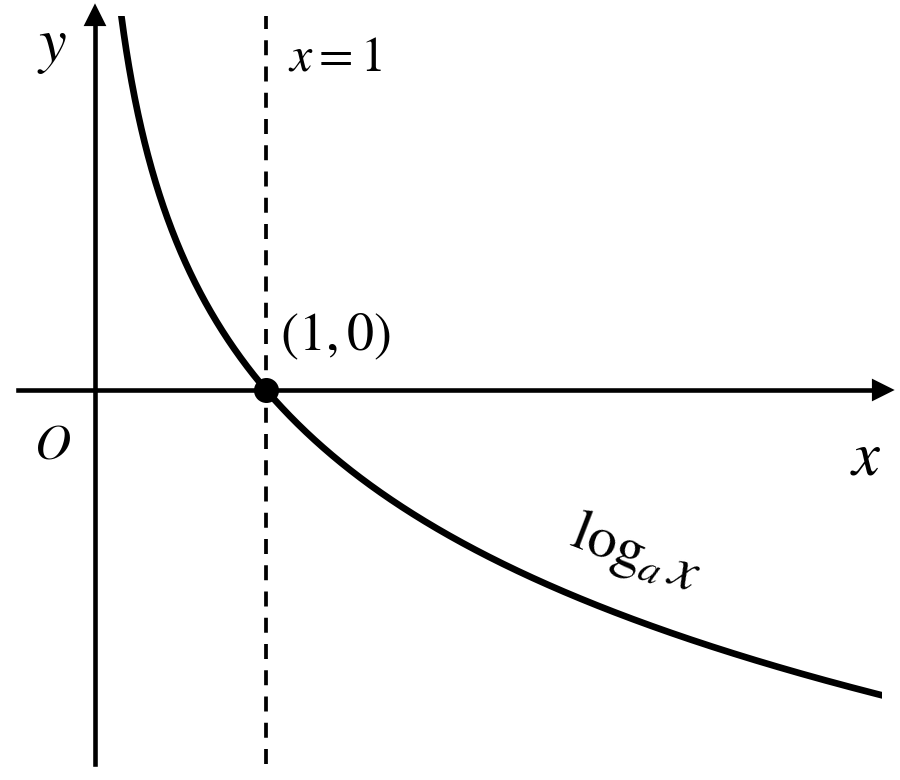{width="230"} |
| 定义域 | $(0, +\infty)$ | $(0, +\infty)$ |
| 值域 | $\mathbb{R}$ | $\mathbb{R}$ |
| 性质 | 过定点 $(1, 0)$，即 $x = 1$ 时，$y = 0$ | 过定点 $(1, 0)$，即 $x = 1$ 时，$y = 0$ |
| | 在 $(0, +\infty)$ 上是增函数 | 在 $(0, +\infty)$ 上是减函数 |
| | 当 $0 < x < 1$ 时，$y < 0$；当 $x \geq 1$ 时，$y \geq 0$ | 当 $0 < x < 1$ 时，$y > 0$；当 $x \geq 1$ 时，$y \leq 0$ |

**注意：**

1. 在同一坐标系内，当 $a > 1$ 时，随 $a$ 的增大，对数函数的图象愈靠近 $x$ 轴；当 $0 < a < 1$ 时，对数函数的图象随 $a$ 的增大而远离 $x$ 轴（见下图）。

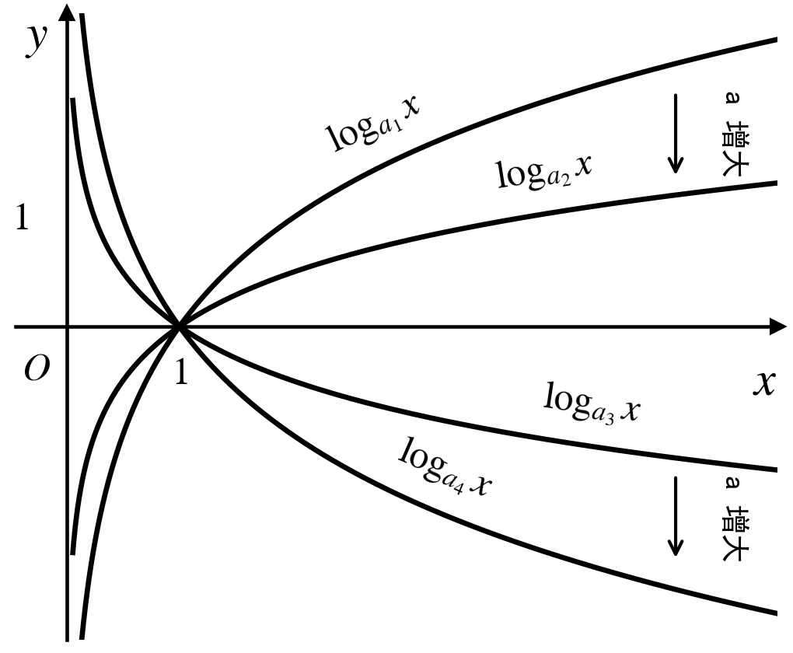{width="520"}

2. 指数函数 $y = a^x\ (a > 0,\ \text{且}\ a \neq 1)$ 与对数函数 $y = \log_a x\ (a > 0,\ \text{且}\ a \neq 1)$ 互为反函数，它们的定义域与值域正好互换，图象关于直线 $y = x$ 对称。

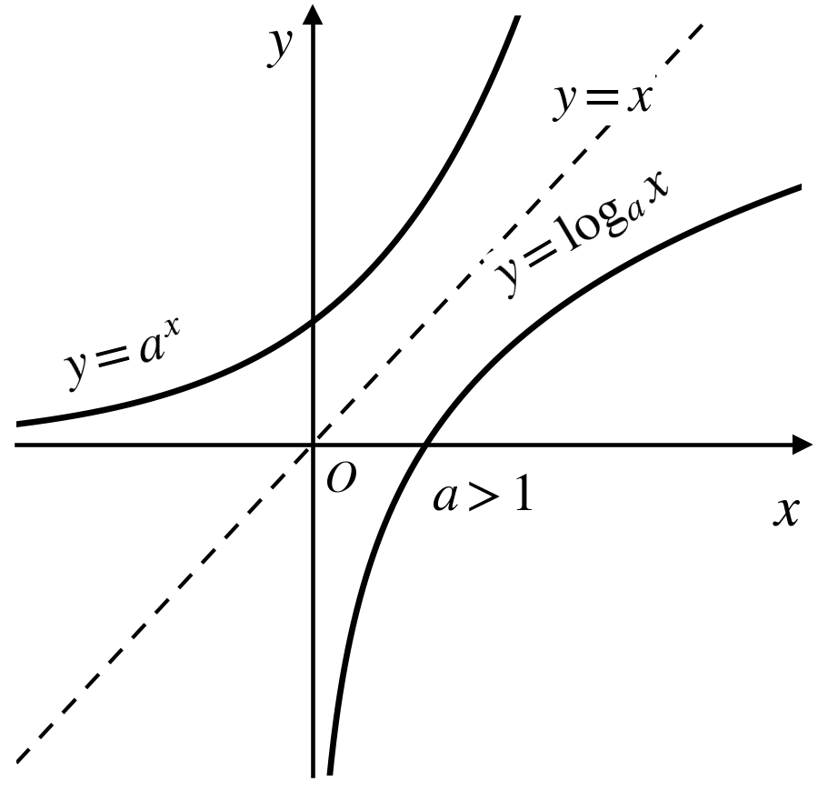{width="310"} 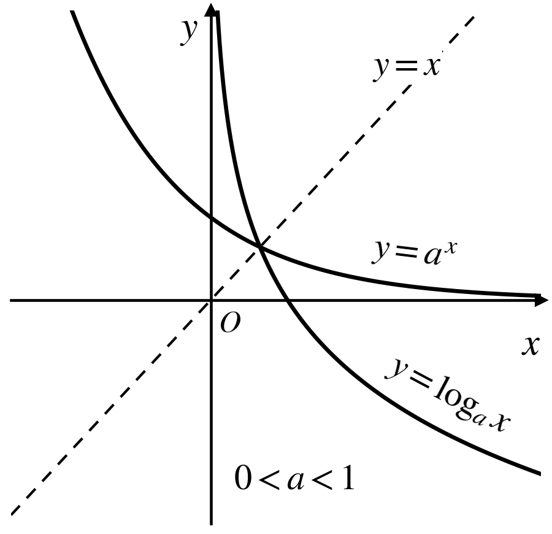{width="310"}

## 十、指对方程与不等式

### 指数与对数方程

利用指数式与对数式的互化、指数函数和对数函数的单调性、换元法，可以求解指数方程和对数方程。解对数方程时必须检查真数大于 $0$；解指数或对数不等式时，要根据底数 $a>1$ 或 $0<a<1$ 判断不等号方向。

### 指对方程与不等式

可以利用指数函数和对数函数的单调性等求解不等式。

- **指数函数：** $y=a^x$ 在 $a>1$ 时，在 $\mathbb{R}$ 上是增函数；在 $0<a<1$ 时，在 $\mathbb{R}$ 上是减函数。
- **对数函数：** $y=\log_a x\ (a>0,\ \text{且}\ a \neq 1)$，在 $a>1$ 时，在 $(0, +\infty)$ 上是增函数；在 $0<a<1$ 时，在 $(0, +\infty)$ 上是减函数。

## 十一、函数综合

### 抽象函数

抽象函数是没有直接给出具体解析式，而只通过一些关系式、性质或条件来描述的函数。

**（1）赋值思想**

根据条件式，令变量分别取 $0$，$1$，$-1$，$2$ 等特殊数值代入，求出某些函数值；当条件中有 $f(x_0)$ 的函数值时，也常将 $x_0$ 代入。另外也可以将 $-x$，$x_1$，$x_2$ 代入，根据定义判断函数的奇偶性和单调性。

**（2）常见性质**

**a. 对称性：**

结论 1：任意函数 $f(x)$ 关于直线 $x=a$ 对称 $\Leftrightarrow f(a+x)=f(a-x) \Leftrightarrow f(2a-x)=f(x)$

推广：$f(a+x)=f(b-x) \Rightarrow f(x)$ 的图象关于 $x=\dfrac{a+b}{2}$ 对称；

结论 2：任意函数 $f(x)$ 关于点 $(a,\ b)$ 中心对称 $\Leftrightarrow f(2a-x)+f(x)=2b$

**b. 周期性：**

结论 1：对任意函数 $y=f(x)$，如果满足 $f(a+x)=f(b+x)$，那么 $|a-b|$ 是周期。

结论 2：对任意函数 $y=f(x)$，如果满足 $f(x+T)=c-f(x)\ (T>0)$，那么 $2T$ 是周期。

结论 3：对任意函数 $y=f(x)$，如果满足 $f(x+T)=\dfrac{c}{f(x)}\ (c \ne 0)$，那么 $2T$ 是周期。

**c. 对称性与周期性的关系：**

性质 1：若函数 $y=f(x)$ 同时关于直线 $x=a$ 与 $x=b$ 轴对称，则函数 $y=f(x)$ 必为周期函数，且 $2|a-b|$ 是周期；

性质 2：若函数 $y=f(x)$ 同时关于点 $(a,\ 0)$ 与点 $(b,\ 0)$ 中心对称，则函数 $y=f(x)$ 必为周期函数，且 $2|a-b|$ 是周期；

性质 3：若函数 $y=f(x)$ 既关于点 $(a,\ 0)$ 中心对称，又关于直线 $x=b$ 轴对称，则函数 $y=f(x)$ 必为周期函数，且 $4|a-b|$ 是周期。

下面三个函数，也是常见的周期函数形式：

$$
f(x+2)=f(x+1)-f(x)\ ;\qquad
f(x+1)=f(x+2)f(x)\ ;\qquad
f(x+1)=\frac{1-f(x)}{1+f(x)}\ .
$$

### 复合函数

复合函数是指一个函数的输出作为另一个函数的输入，形成如 $f(g(x))$ 或 $f(f(x))$ 的结构。其中，$g(x)$ 为内层函数，$f(x)$ 为外层函数。
