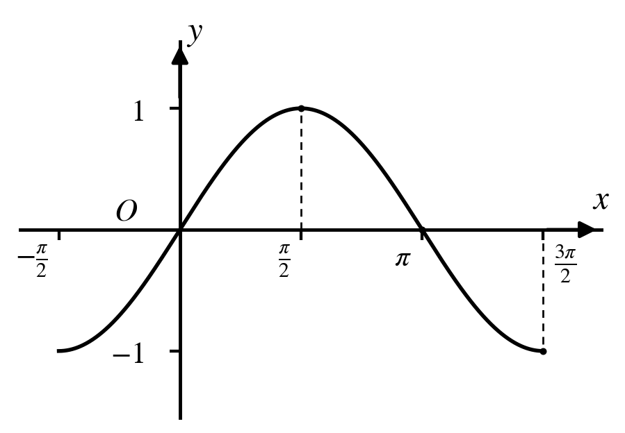
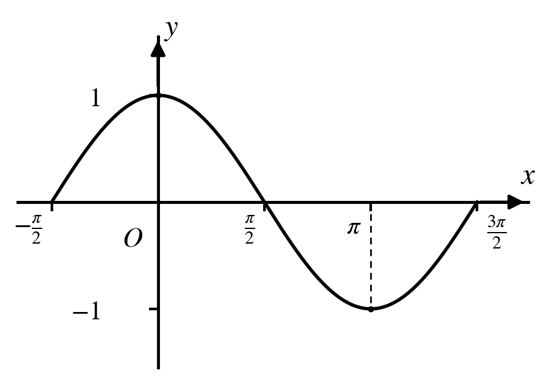
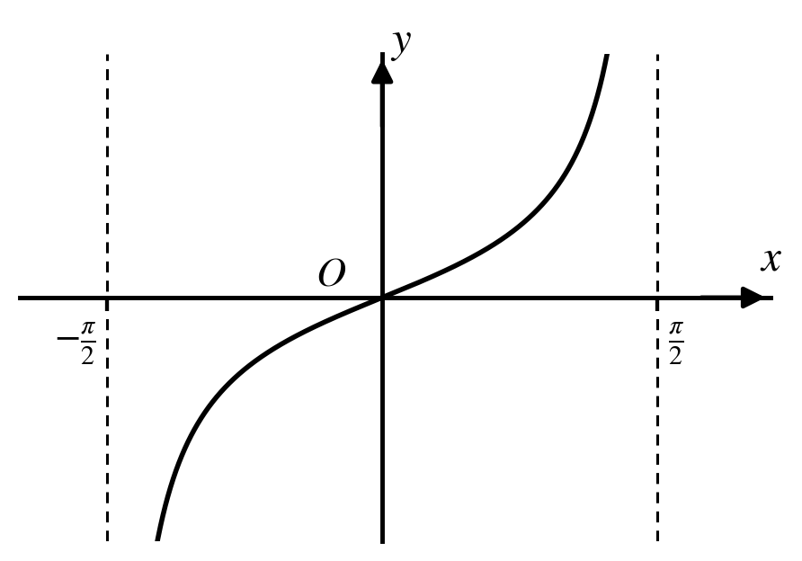

# 三角

本页涵盖三角函数的定义与恒等变换、解三角形，以及三角函数的图象与性质。它是向量、复数中用"模"与"角"描述问题的基础。

## 一、三角的定义与概念

### 任意角及其度量

(1) 角的分类：正角（逆时针旋转）、负角（顺时针旋转）、零角（未旋转）。

(2) 终边相同的角集合表示：$\{\beta \mid \beta = \alpha + k \cdot 360^\circ,\ k \in \mathbb{Z}\}$。

(3) 角度制与弧度制互化：$180^\circ = \pi$。

- 角度转弧度：弧度数 $=$ 角度值 $\times \dfrac{\pi}{180^\circ}$；
- 弧度转角度：角度值 $=$ 弧度数 $\times \dfrac{180^\circ}{\pi}$。

(4) 弧长公式 $l = |\alpha| r$；扇形面积公式 $S = \dfrac{1}{2}lr = \dfrac{1}{2}|\alpha|r^2$。

### 任意角的三角函数

**定义：** 设角 $\alpha$ 终边上一点 $P(x, y)$，$r = \sqrt{x^2 + y^2} > 0$，则

正弦：$\sin\alpha = \dfrac{y}{r}$；余弦：$\cos\alpha = \dfrac{x}{r}$；正切：$\tan\alpha = \dfrac{y}{x}$；余切：$\cot\alpha = \dfrac{x}{y}$。

单位圆上的点可表示为 $(\cos\alpha,\ \sin\alpha)$。

**同角三角函数基本关系：**

- 平方关系：$\sin^2\alpha + \cos^2\alpha = 1$
- 商数关系：$\tan\alpha = \dfrac{\sin\alpha}{\cos\alpha}$
- 倒数关系：$\tan\alpha \cdot \cot\alpha = 1$

### 诱导公式

(1) 通用规律："奇变偶不变，符号看象限"。对 $k \cdot \dfrac{\pi}{2} \pm \alpha$ 形式的角，当 $k$ 为奇数时函数名改变（正弦与余弦互换、正切与余切互换），$k$ 为偶数时函数名不变；符号则是把 $\alpha$ 看作锐角时，原角所在象限内原函数值的符号。把 $\alpha$ 看成锐角，只是为了记忆方便，实际上 $\alpha$ 可以是任意角。

(2) 负化正，大化小，化到锐角为终了。用诱导公式求值时，要善于观察所给角之间的关系，利用整体代换的思想简化解题过程。常见的互余关系有 $\dfrac{\pi}{3} - \alpha$ 与 $\dfrac{\pi}{6} + \alpha$，$\dfrac{\pi}{3} + \alpha$ 与 $\dfrac{\pi}{6} - \alpha$，$\dfrac{\pi}{4} + \alpha$ 与 $\dfrac{\pi}{4} - \alpha$ 等；常见的互补关系有 $\dfrac{\pi}{6} - \theta$ 与 $\dfrac{5\pi}{6} + \theta$，$\dfrac{\pi}{3} + \theta$ 与 $\dfrac{2\pi}{3} - \theta$，$\dfrac{\pi}{4} + \theta$ 与 $\dfrac{3\pi}{4} - \theta$ 等。

## 二、三角恒等式

### 两角和与差的公式

(1) $\cos(\alpha - \beta) = \cos\alpha\cos\beta + \sin\alpha\sin\beta$；

(2) $\cos(\alpha + \beta) = \cos\alpha\cos\beta - \sin\alpha\sin\beta$；

(3) $\sin(\alpha - \beta) = \sin\alpha\cos\beta - \cos\alpha\sin\beta$；

(4) $\sin(\alpha + \beta) = \sin\alpha\cos\beta + \cos\alpha\sin\beta$；

(5) $\tan(\alpha - \beta) = \dfrac{\tan\alpha - \tan\beta}{1 + \tan\alpha\tan\beta}$，即 $\tan\alpha - \tan\beta = \tan(\alpha - \beta)(1 + \tan\alpha\tan\beta)$；

(6) $\tan(\alpha + \beta) = \dfrac{\tan\alpha + \tan\beta}{1 - \tan\alpha\tan\beta}$，即 $\tan\alpha + \tan\beta = \tan(\alpha + \beta)(1 - \tan\alpha\tan\beta)$。

### 二倍角公式

(1) $\sin 2\alpha = 2\sin\alpha\cos\alpha$。

$$
\Rightarrow 1 \pm \sin 2\alpha = \sin^2\alpha + \cos^2\alpha \pm 2\sin\alpha\cos\alpha = (\sin\alpha \pm \cos\alpha)^2
$$

(2) $\cos 2\alpha = \cos^2\alpha - \sin^2\alpha = 2\cos^2\alpha - 1 = 1 - 2\sin^2\alpha$。

$$
\Rightarrow \text{升幂公式：}\ 1 + \cos\alpha = 2\cos^2\frac{\alpha}{2},\quad 1 - \cos\alpha = 2\sin^2\frac{\alpha}{2}
$$

$$
\Rightarrow \text{降幂公式：}\ \cos^2\alpha = \frac{\cos 2\alpha + 1}{2},\quad \sin^2\alpha = \frac{1 - \cos 2\alpha}{2}
$$

(3) $\tan 2\alpha = \dfrac{2\tan\alpha}{1 - \tan^2\alpha}$。

### 半角公式

$$
\sin\frac{\alpha}{2} = \pm\sqrt{\frac{1 - \cos\alpha}{2}},\qquad
\cos\frac{\alpha}{2} = \pm\sqrt{\frac{1 + \cos\alpha}{2}},\qquad
\tan\frac{\alpha}{2} = \pm\sqrt{\frac{1 - \cos\alpha}{1 + \cos\alpha}}
$$

$$
\tan\frac{\alpha}{2} = \frac{\sin\frac{\alpha}{2}}{\cos\frac{\alpha}{2}}
= \frac{\sin\frac{\alpha}{2} \cdot 2\cos\frac{\alpha}{2}}{\cos\frac{\alpha}{2} \cdot 2\cos\frac{\alpha}{2}}
= \frac{\sin\alpha}{1 + \cos\alpha},
$$

$$
\tan\frac{\alpha}{2} = \frac{\sin\frac{\alpha}{2}}{\cos\frac{\alpha}{2}}
= \frac{\sin\frac{\alpha}{2} \cdot 2\sin\frac{\alpha}{2}}{\cos\frac{\alpha}{2} \cdot 2\sin\frac{\alpha}{2}}
= \frac{1 - \cos\alpha}{\sin\alpha}.
$$

其中，公式右侧的"$\pm$"号，根据 $\dfrac{\alpha}{2}$ 所在的象限由左侧相应的符号确定。

### 万能公式

$$
\sin x = \frac{2\tan\frac{x}{2}}{1 + \tan^2\frac{x}{2}},\qquad
\cos x = \frac{1 - \tan^2\frac{x}{2}}{1 + \tan^2\frac{x}{2}},\qquad
\tan x = \frac{2\tan\frac{x}{2}}{1 - \tan^2\frac{x}{2}}
$$

思考：如何推导万能公式？（提示：把 $\sin x$、$\cos x$ 写成 $\dfrac{x}{2}$ 的二倍角，再分子分母同除以 $\cos^2\dfrac{x}{2}$。）

### 三倍角公式

正弦三倍角公式：$\sin 3\theta = 3\sin\theta - 4\sin^3\theta$

$$
= 4\sin\theta \cdot \sin\left(\frac{\pi}{3} - \theta\right) \cdot \sin\left(\frac{\pi}{3} + \theta\right)
$$

余弦三倍角公式：$\cos 3\theta = 4\cos^3\theta - 3\cos\theta$

$$
= 4\cos\theta \cdot \cos\left(\frac{\pi}{3} - \theta\right) \cdot \cos\left(\frac{\pi}{3} + \theta\right)
$$

正切三倍角公式：$\tan 3\theta = \dfrac{3\tan\theta - \tan^3\theta}{1 - 3\tan^2\theta} = \tan\theta \cdot \tan\left(\dfrac{\pi}{3} - \theta\right) \cdot \tan\left(\dfrac{\pi}{3} + \theta\right)$

思考：如何推导三倍角公式？（提示：用 $\theta + 2\theta$ 展开。）

### 辅助角公式

$a\sin x - b\cos x = \sqrt{a^2 + b^2}\sin(x - \varphi)$，其中 $\tan\varphi = \dfrac{b}{a}$；

$a\cos x + b\sin x = \sqrt{a^2 + b^2}\cos(x - \varphi)$，其中 $\tan\varphi = \dfrac{b}{a}$；

$a\cos x - b\sin x = \sqrt{a^2 + b^2}\cos(x + \varphi)$，其中 $\tan\varphi = \dfrac{b}{a}$。

### 和差化积公式

设 $\alpha + \beta = x$，$\alpha - \beta = y$，则 $\alpha = \dfrac{x + y}{2}$，$\beta = \dfrac{x - y}{2}$。这样，积化和差公式可以写成：

$\sin x + \sin y = 2\sin\dfrac{x + y}{2}\cos\dfrac{x - y}{2}$；

$\sin x - \sin y = 2\cos\dfrac{x + y}{2}\sin\dfrac{x - y}{2}$；

$\cos x + \cos y = 2\cos\dfrac{x + y}{2}\cos\dfrac{x - y}{2}$；

$\cos x - \cos y = -2\sin\dfrac{x + y}{2}\sin\dfrac{x - y}{2}$。

### 已知三角函数值求角

若 $\sin x = \sin\alpha$，则解集为：$\{x \mid x = k\pi + (-1)^k\alpha,\ k \in \mathbb{Z}\}$；

若 $\cos x = \cos\alpha$，则解集为：$\{x \mid x = 2k\pi \pm \alpha,\ k \in \mathbb{Z}\}$；

若 $\tan x = \tan\alpha$，则解集为：$\{x \mid x = k\pi + \alpha,\ k \in \mathbb{Z}\}$。

## 三、解三角形（一）：正弦定理与余弦定理

### 正弦定理

在 $\triangle ABC$ 中，内角 $A, B, C$ 的对边分别为 $a, b, c$，则

$$
\frac{a}{\sin A} = \frac{b}{\sin B} = \frac{c}{\sin C} = 2R
$$

其中 $R$ 为 $\triangle ABC$ 外接圆的半径。

**(1) 变形：**

$$
a = 2R\sin A,\quad b = 2R\sin B,\quad c = 2R\sin C
$$

$$
\sin A : \sin B : \sin C = a : b : c
$$

**(2) 用途：** ① 已知两角一边；② 已知两边及其一边的对角；③ 边角互化。

### 余弦定理

在 $\triangle ABC$ 中，内角 $A, B, C$ 的对边分别为 $a, b, c$，则

$$
a^2 = b^2 + c^2 - 2bc\cos A
$$

$$
b^2 = a^2 + c^2 - 2ac\cos B
$$

$$
c^2 = a^2 + b^2 - 2ab\cos C
$$

**求角变式：**

$$
\cos A = \frac{b^2 + c^2 - a^2}{2bc}
$$

**用途：** ① 已知三边求角；② 已知两边及夹角求第三边；③ 判断三角形是锐角三角形还是钝角三角形。

## 四、解三角形（二）：面积与综合应用

### 三角形面积公式

(1) $S = \dfrac{1}{2}ah_a = \dfrac{1}{2}bh_b = \dfrac{1}{2}ch_c$（底乘高）；

(2) $S = \dfrac{1}{2}ab\sin C = \dfrac{1}{2}bc\sin A = \dfrac{1}{2}ac\sin B$（高频）；

(3) $S = \dfrac{abc}{4R}$（外接圆）。

!!! note "拓展：三角形常用面积公式"

    (1) $S_{\triangle ABC} = \dfrac{1}{2}ah_a$（$h_a$ 表示边 $a$ 上的高）；

    (2) $S_{\triangle ABC} = \dfrac{1}{2}r(a+b+c)$（$r$ 是三角形内切圆的半径）；

    (3) $S_{\triangle ABC} = \sqrt{p(p-a)(p-b)(p-c)}$，即海伦公式，其中 $p = \dfrac{1}{2}(a+b+c)$ 为 $\triangle ABC$ 的半周长。

### 正弦定理与余弦定理综合

核心原则：边化角，角化边。

### 解三角形的应用

核心原则：将实际问题转化为三角问题，注意角的取值范围。

## 五、三角函数的图象与性质

### 五点法作图

(1) 在正弦函数 $y=\sin x$，$x\in[0,\ 2\pi]$ 的图象中，五个关键点是：$(0,\ 0)$，$\left(\dfrac{\pi}{2},\ 1\right)$，$(\pi,\ 0)$，$\left(\dfrac{3\pi}{2},\ -1\right)$，$(2\pi,\ 0)$。

(2) 在余弦函数 $y=\cos x$，$x\in[0,\ 2\pi]$ 的图象中，五个关键点是：$(0,\ 1)$，$\left(\dfrac{\pi}{2},\ 0\right)$，$(\pi,\ -1)$，$\left(\dfrac{3\pi}{2},\ 0\right)$，$(2\pi,\ 1)$。

### 正弦、余弦、正切函数的图象与性质

下表中 $k\in\mathbb{Z}$。

| 函数 | $y=\sin x$ | $y=\cos x$ | $y=\tan x$ |
|:---|:---:|:---:|:---:|
| 图象 | {width="240"} | {width="240"} | {width="240"} |
| 定义域 | $\mathbb{R}$ | $\mathbb{R}$ | $\left\{x \mid x \ne k\pi+\dfrac{\pi}{2}\right\}$ |
| 值域 | $[-1,\ 1]$ | $[-1,\ 1]$ | $\mathbb{R}$ |
| 最小正周期 | $2\pi$ | $2\pi$ | $\pi$ |
| 奇偶性 | 奇函数 | 偶函数 | 奇函数 |
| 严格增区间 | $\left[2k\pi-\dfrac{\pi}{2},\ 2k\pi+\dfrac{\pi}{2}\right]$ | $[2k\pi-\pi,\ 2k\pi]$ | $\left(k\pi-\dfrac{\pi}{2},\ k\pi+\dfrac{\pi}{2}\right)$ |
| 严格减区间 | $\left[2k\pi+\dfrac{\pi}{2},\ 2k\pi+\dfrac{3\pi}{2}\right]$ | $[2k\pi,\ 2k\pi+\pi]$ | 无 |
| 对称中心 | $(k\pi,\ 0)$ | $\left(k\pi+\dfrac{\pi}{2},\ 0\right)$ | $\left(\dfrac{k\pi}{2},\ 0\right)$ |
| 对称轴方程 | $x=k\pi+\dfrac{\pi}{2}$ | $x=k\pi$ | 无 |

!!! warning "易错"

    正切函数的定义域不要写成并集 $\bigcup\limits_{k\in\mathbb{Z}}\left(k\pi-\dfrac{\pi}{2},\ k\pi+\dfrac{\pi}{2}\right)$，而应写成集合形式 $\left\{x \mid x \ne k\pi+\dfrac{\pi}{2}\right\}$（并集写法容易漏掉"每个区间之间不连续"这一点）。

### 周期、对称与奇偶性的常用结论

(1) 正弦型曲线、余弦型曲线相邻两个对称中心、相邻两条对称轴之间的距离是 $\dfrac{1}{2}$ 个周期，相邻的对称中心与对称轴之间的距离是 $\dfrac{1}{4}$ 个周期。

(2) 若 $y=A\sin(\omega x+\varphi)$ 为偶函数，则 $\varphi=k\pi+\dfrac{\pi}{2}\ (k\in\mathbb{Z})$；若为奇函数，则 $\varphi=k\pi\ (k\in\mathbb{Z})$。

(3) 若 $y=A\cos(\omega x+\varphi)$ 为偶函数，则 $\varphi=k\pi\ (k\in\mathbb{Z})$；若为奇函数，则 $\varphi=k\pi+\dfrac{\pi}{2}\ (k\in\mathbb{Z})$。

### 易错点

(1) 求函数 $y=A\sin(\omega x+\varphi)$ 的单调区间时，要注意 $A$ 和 $\omega$ 的符号，尽量化成 $\omega>0$ 的情况，避免出现增减区间的混淆。

(2) 对于 $y=\tan x$，是在每个区间 $\left(k\pi-\dfrac{\pi}{2},\ k\pi+\dfrac{\pi}{2}\right)(k\in\mathbb{Z})$ 上严格增，不能认为其在定义域上为增函数。

## 六、正弦型函数的图象与性质

### 简谐运动的相关概念

已知函数 $y=A\sin(\omega x+\varphi)\ (A>0,\ \omega>0),\ x \ge 0$：

| $A$ | $T = \frac{2\pi}{\omega}$ | $f = \frac{1}{T} = \frac{\omega}{2\pi}$ | $\omega x+\varphi$ | $\varphi$ | $\omega$ |
| :---: | :---: | :---: | :---: | :---: | :---: |
| 振幅 | 周期 | 频率 | 相位 | 初相 | 圆频率 |

### 五点法作图

用"五点法"画 $y=A\sin(\omega x+\varphi)\ (A>0,\ \omega>0)$ 一个周期内的简图：

| $\omega x+\varphi$ | $0$ | $\frac{\pi}{2}$ | $\pi$ | $\frac{3\pi}{2}$ | $2\pi$ |
| :---: | :---: | :---: | :---: | :---: | :---: |
| $x$ | $\dfrac{0-\varphi}{\omega}$ | $\dfrac{\dfrac{\pi}{2}-\varphi}{\omega}$ | $\dfrac{\pi-\varphi}{\omega}$ | $\dfrac{\dfrac{3\pi}{2}-\varphi}{\omega}$ | $\dfrac{2\pi-\varphi}{\omega}$ |
| $y=A\sin(\omega x+\varphi)$ | $0$ | $A$ | $0$ | $-A$ | $0$ |

### 图象变换

由 $y=\sin x$ 的图象变换得到 $y=A\sin(\omega x+\varphi)\ (A>0,\ \omega>0)$ 的图象，有两条路线：

### 常用结论

(1) "五点法"作图中，相邻两点的横向距离均为 $\dfrac{T}{4}$。

(2) 若直线 $x=a$ 为正（余）弦型曲线的对称轴，则该函数一定在 $x=a$ 处取得最值。

(3) 函数 $y=A\sin(\omega x+\varphi)+k\ (A>0,\ \omega>0)$ 图象平移的规律："左加右减，上加下减"。

### 易错点

(1) 分清"先平移后伸缩"还是"先伸缩后平移"，注意先伸缩后平移时平移距离为 $\left|\dfrac{\varphi}{\omega}\right|$ 个单位长度。

(2) 不要混淆横向、纵向的缩小、扩大与系数的关系。
