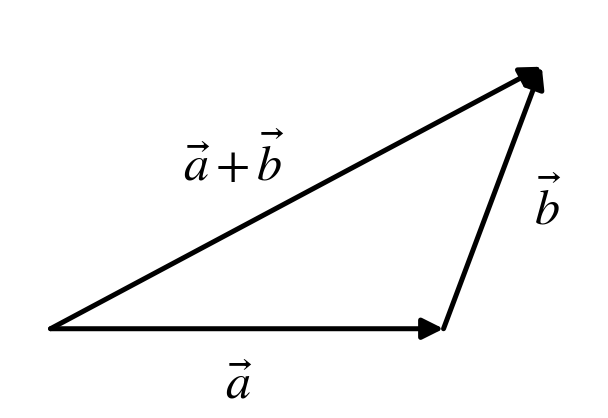
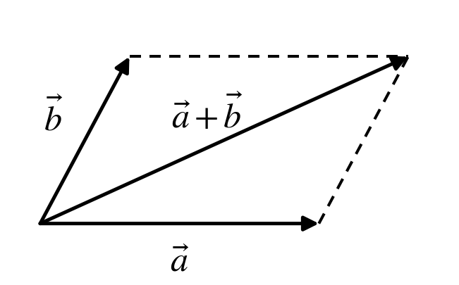
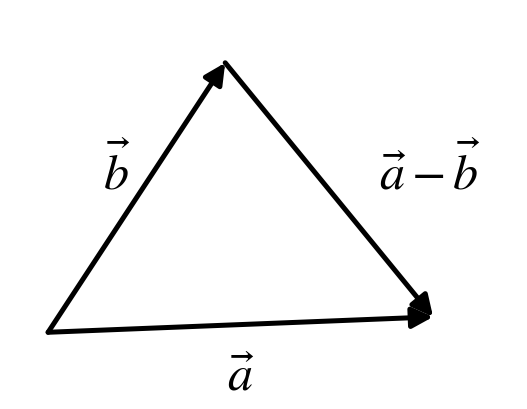
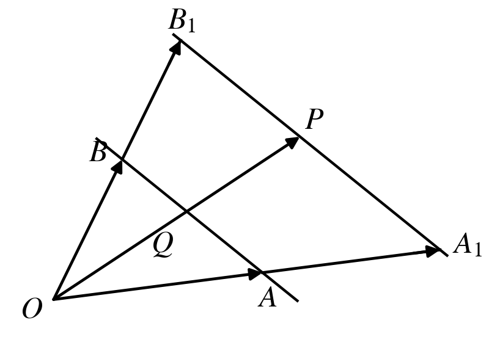
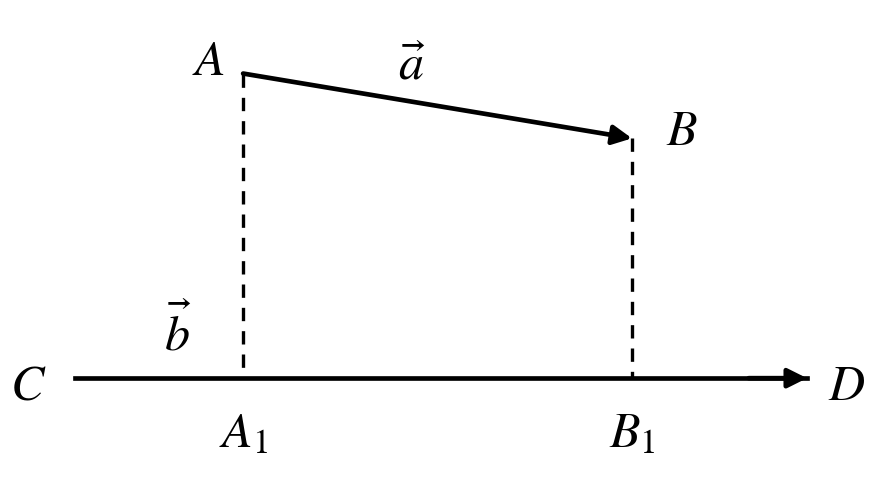
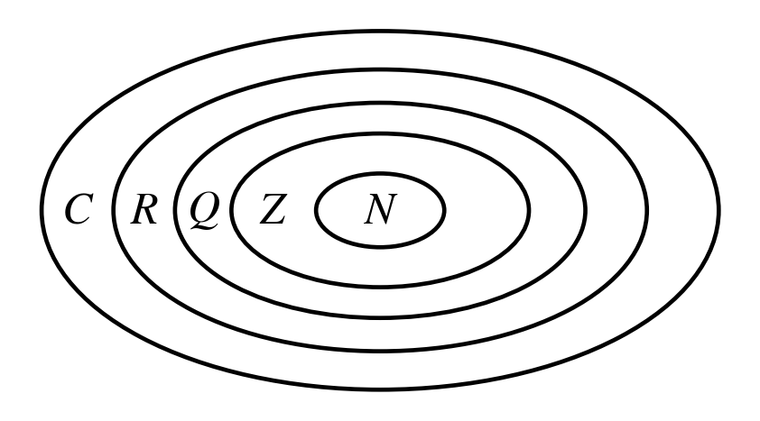
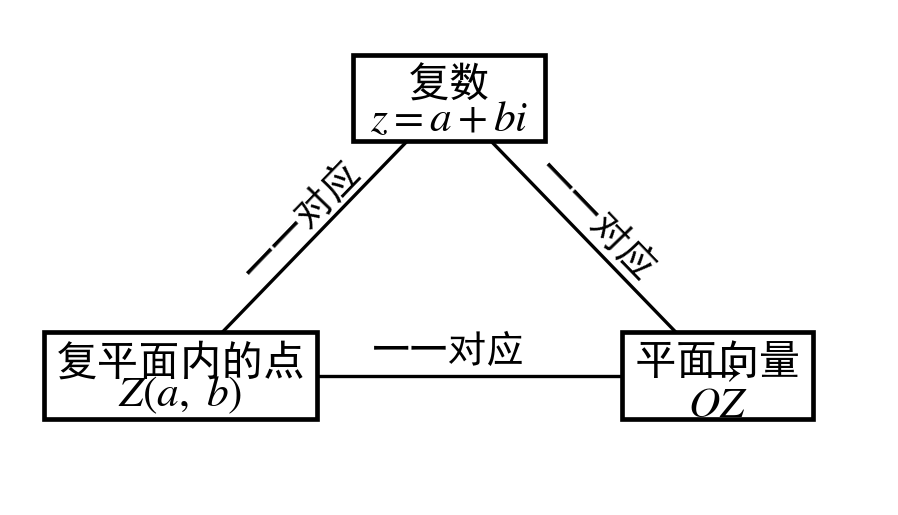
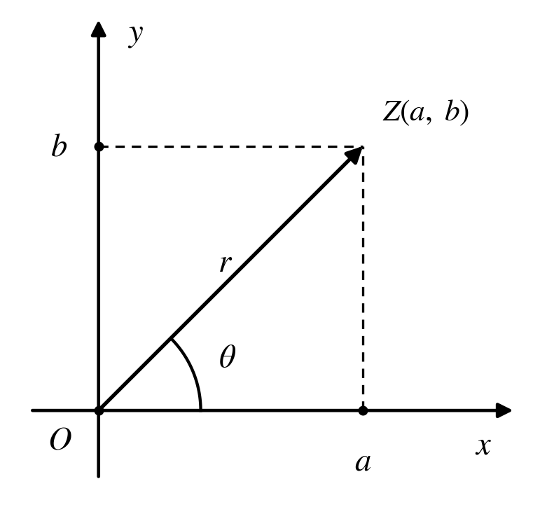

# 平面向量与复数

本页把平面向量与复数放在一起：向量是"有方向的量"，复数则是复平面上的点或向量，两者共用同一套几何语言（模、夹角、平行四边形法则）。这也正好呼应了前面"三角不等式"在向量、复数中的真正含义。

## 一、平面向量的概念与线性运算

### 向量的相关概念

| 名称 | 定义 | 备注 |
|:---:|:---:|:---:|
| 向量 | 既有大小又有方向的量 | 平面向量是自由向量 |
| 长度（模） | 向量的大小 | 记作 $\lvert\vec a\rvert$ 或 $\lvert\overrightarrow{AB}\rvert$ |
| 零向量 | 长度为 $0$，其方向是任意的 | 记作 $\vec 0$ |
| 单位向量 | 长度等于 $1$ 个单位长度的向量 | 与非零向量 $\vec a$ 共线的单位向量为 $\pm\dfrac{\vec a}{\lvert\vec a\rvert}$ |
| 平行向量 （共线向量） | 方向相同或相反的非零向量 | $\vec 0$ 与任意向量平行（或共线） |
| 相等向量 | 长度相等且方向相同的向量 | 两向量不能比较大小 |
| 相反向量 | 长度相等且方向相反的向量 | $\vec 0$ 的相反向量为 $\vec 0$ |

### 线性运算

| 向量运算 | 法则（或几何意义） | 运算律 |
|:---:|:---|:---|
| 加法 | {width="210"} 三角形法则 {width="210"} 平行四边形法则 | 交换律：$\vec a+\vec b=\vec b+\vec a$； 结合律：$(\vec a+\vec b)+\vec c=\vec a+(\vec b+\vec c)$ |
| 减法 | {width="210"} 几何意义 | $\vec a-\vec b=\vec a+(-\vec b)$ |
| 数乘 | $\lvert\lambda\vec a\rvert=\lvert\lambda\rvert\lvert\vec a\rvert$，当 $\lambda>0$ 时，$\lambda\vec a$ 的方向与 $\vec a$ 的方向相同；当 $\lambda<0$ 时，$\lambda\vec a$ 的方向与 $\vec a$ 的方向相反；当 $\lambda=0$ 时，$\lambda\vec a=\vec 0$ | 设 $\lambda$，$\mu$ 为实数，则 $\lambda(\mu\vec a)=(\lambda\mu)\vec a$； $(\lambda+\mu)\vec a=\lambda\vec a+\mu\vec a$； $\lambda(\vec a+\vec b)=\lambda\vec a+\lambda\vec b$ |

### 共线定理与等和线

(1) 向量 $\vec a\ (\vec a \ne \vec 0)$ 与 $\vec b$ 共线的充要条件是：存在唯一一个实数 $\lambda$，使 $\vec b=\lambda\vec a$。

(2) 平面内取一组基底 $\overrightarrow{OA}$，$\overrightarrow{OB}$，对任一向量 $\overrightarrow{OP}$，有 $\overrightarrow{OP}=\lambda\overrightarrow{OA}+\mu\overrightarrow{OB}\ (\lambda,\ \mu \in \mathbb{R})$。若点 $P$ 在直线 $AB$ 上或者在平行于 $AB$ 的直线上，则 $\lambda+\mu=k$（定值），反之也成立。我们把直线 $AB$ 以及与直线 $AB$ 平行的直线称为**等和线**。

{width="330"}

当等和线恰为直线 $AB$ 时，$k=1$；当等和线在点 $O$ 和直线 $AB$ 之间时，$k \in (0,\ 1)$；

当直线 $AB$ 在点 $O$ 与等和线之间时，$k \in (1,\ +\infty)$；当等和线过点 $O$ 时，$k=0$。

### 平面向量基本定理

如果 $\vec e_1$，$\vec e_2$ 是同一平面内的两个不共线向量，那么对于这一平面内的任一向量 $\vec a$，有且只有一对实数 $\lambda_1$，$\lambda_2$，使 $\vec a=\lambda_1\vec e_1+\lambda_2\vec e_2$。

若 $\vec e_1$，$\vec e_2$ 不共线，我们把 $\{\vec e_1,\ \vec e_2\}$ 叫做表示这一平面内所有向量的一个基底。

特别地，把一个向量分解为两个互相垂直的向量，叫做把向量作正交分解。

### 坐标运算

**(1) 向量加法、减法、数乘运算及向量的模**

设 $\vec a=(x_1,\ y_1)$，$\vec b=(x_2,\ y_2)$，则

$$
\vec a+\vec b=(x_1+x_2,\ y_1+y_2),\quad
\vec a-\vec b=(x_1-x_2,\ y_1-y_2),\quad
\lambda\vec a=(\lambda x_1,\ \lambda y_1),\quad
\lvert\vec a\rvert=\sqrt{x_1^2+y_1^2}.
$$

**(2) 向量坐标的求法**

① 若向量的起点是坐标原点，则终点坐标即为向量的坐标。

② 设 $A(x_1,\ y_1)$，$B(x_2,\ y_2)$，则 $\overrightarrow{AB}=(x_2-x_1,\ y_2-y_1)$，$\lvert\overrightarrow{AB}\rvert=\sqrt{(x_2-x_1)^2+(y_2-y_1)^2}$。

**(3) 平面向量共线的坐标表示**

设 $\vec a=(x_1,\ y_1)$，$\vec b=(x_2,\ y_2)$，其中 $\vec b \ne \vec 0$，则 $\vec a \parallel \vec b \Leftrightarrow x_1y_2-x_2y_1=0$。

## 二、平面向量的数量积

### 夹角

已知两个非零向量 $\vec a$，$\vec b$，$O$ 是平面上的任意一点，作 $\overrightarrow{OA}=\vec a$，$\overrightarrow{OB}=\vec b$，则 $\angle AOB=\theta\ (0 \le \theta \le \pi)$ 叫做向量 $\vec a$ 与 $\vec b$ 的夹角。

**有关向量夹角的两个结论：**

① 若 $\vec a$ 与 $\vec b$ 的夹角为锐角，则 $\vec a \cdot \vec b>0$；反之，若 $\vec a \cdot \vec b>0$，则 $\vec a$ 与 $\vec b$ 的夹角为锐角或 $0$。

② 若 $\vec a$ 与 $\vec b$ 的夹角为钝角，则 $\vec a \cdot \vec b<0$；反之，若 $\vec a \cdot \vec b<0$，则 $\vec a$ 与 $\vec b$ 的夹角为钝角或 $\pi$。

### 数量积的定义与几何意义

已知两个非零向量 $\vec a$ 与 $\vec b$，它们的夹角为 $\theta$，我们把数量 $\lvert\vec a\rvert\lvert\vec b\rvert\cos\theta$ 叫做向量 $\vec a$ 与 $\vec b$ 的数量积，记作 $\vec a \cdot \vec b$。

{width="330"}

设 $\vec a$，$\vec b$ 是两个非零向量，它们的夹角是 $\theta$，$\vec e$ 是与 $\vec b$ 方向相同的单位向量，$\overrightarrow{AB}=\vec a$，$\overrightarrow{CD}=\vec b$。过 $\overrightarrow{AB}$ 的起点 $A$ 和终点 $B$，分别作 $\overrightarrow{CD}$ 所在直线的垂线，垂足分别为 $A_1$，$B_1$，得到 $\overrightarrow{A_1B_1}$。我们称上述变换为向量 $\vec a$ 向向量 $\vec b$ 投影，$\overrightarrow{A_1B_1}$ 叫做向量 $\vec a$ 在向量 $\vec b$ 上的投影向量，记为 $\lvert\vec a\rvert\cos\theta\ \vec e$。

### 运算律

$$
\vec a \cdot \vec b=\vec b \cdot \vec a\ ;\qquad
(\lambda\vec a)\cdot\vec b=\lambda(\vec a\cdot\vec b)=\vec a\cdot(\lambda\vec b)\ (\lambda\in\mathbb{R})\ ;\qquad
(\vec a+\vec b)\cdot\vec c=\vec a\cdot\vec c+\vec b\cdot\vec c\ .
$$

### 数量积的常用结论

已知非零向量 $\vec a=(x_1,\ y_1)$，$\vec b=(x_2,\ y_2)$，$\vec a$ 与 $\vec b$ 的夹角为 $\theta$。

| | 几何表示 | 坐标表示 |
|:---:|:---:|:---:|
| 数量积 | $\vec a\cdot\vec b=\lvert\vec a\rvert\lvert\vec b\rvert\cos\theta$ | $\vec a\cdot\vec b=x_1x_2+y_1y_2$ |
| 模 | $\lvert\vec a\rvert=\sqrt{\vec a\cdot\vec a}$ | $\lvert\vec a\rvert=\sqrt{x_1^2+y_1^2}$ |
| 夹角 | $\cos\theta=\dfrac{\vec a\cdot\vec b}{\lvert\vec a\rvert\lvert\vec b\rvert}$ | $\cos\theta=\dfrac{x_1x_2+y_1y_2}{\sqrt{x_1^2+y_1^2}\sqrt{x_2^2+y_2^2}}$ |
| $\vec a \perp \vec b$ 的充要条件 | $\vec a\cdot\vec b=0$ | $x_1x_2+y_1y_2=0$ |
| $\lvert\vec a\cdot\vec b\rvert$ 与 $\lvert\vec a\rvert\lvert\vec b\rvert$ 的关系 | $\lvert\vec a\cdot\vec b\rvert \le \lvert\vec a\rvert\lvert\vec b\rvert$ | $\lvert x_1x_2+y_1y_2\rvert \le \sqrt{(x_1^2+y_1^2)(x_2^2+y_2^2)}$ |

## 三、平面向量的常用结论

### 极化恒等式

设 $\vec a$，$\vec b$ 是平面内的两个向量，则有

$$
\vec a\cdot\vec b=\frac{1}{4}\left[(\vec a+\vec b)^2-(\vec a-\vec b)^2\right]
$$

**证明：** 右边 $=\dfrac{1}{4}\left[\vec a^2+2\vec a\cdot\vec b+\vec b^2-\vec a^2+2\vec a\cdot\vec b-\vec b^2\right]=\vec a\cdot\vec b$。

### 三角形的"四心"

**重心：** 设点 $G$ 是 $\triangle ABC$ 所在平面内的一点，则当 $G$ 是 $\triangle ABC$ 的重心时，有

$$
\overrightarrow{GA}+\overrightarrow{GB}+\overrightarrow{GC}=\vec 0
\quad\text{或}\quad
\overrightarrow{PG}=\frac{1}{3}\left(\overrightarrow{PA}+\overrightarrow{PB}+\overrightarrow{PC}\right)
$$

（其中 $P$ 为平面内任意一点）。

在向量的坐标表示中，若 $G$、$A$、$B$、$C$ 分别是三角形的重心和三个顶点，且坐标分别为 $G(x,\ y)$、$A(x_1,\ y_1)$、$B(x_2,\ y_2)$、$C(x_3,\ y_3)$，则有

$$
G\left(\frac{x_1+x_2+x_3}{3},\ \frac{y_1+y_2+y_3}{3}\right)
$$

**外心：** 若点 $O$ 是 $\triangle ABC$ 的外心，则 $\lvert\overrightarrow{OA}\rvert=\lvert\overrightarrow{OB}\rvert=\lvert\overrightarrow{OC}\rvert$，或

$$
\left(\overrightarrow{OA}+\overrightarrow{OB}\right)\cdot\overrightarrow{BA}
=\left(\overrightarrow{OB}+\overrightarrow{OC}\right)\cdot\overrightarrow{CB}
=\left(\overrightarrow{OC}+\overrightarrow{OA}\right)\cdot\overrightarrow{AC}=0\ ;
$$

**内心：** 若点 $I$ 是 $\triangle ABC$ 的内心，则有

$$
\lvert\overrightarrow{BC}\rvert\cdot\overrightarrow{IA}
+\lvert\overrightarrow{CA}\rvert\cdot\overrightarrow{IB}
+\lvert\overrightarrow{AB}\rvert\cdot\overrightarrow{IC}=\vec 0
$$

**垂心：** 若 $H$ 是 $\triangle ABC$ 的垂心，则 $\overrightarrow{HA}\cdot\overrightarrow{HB}=\overrightarrow{HB}\cdot\overrightarrow{HC}=\overrightarrow{HC}\cdot\overrightarrow{HA}$，或

$$
\overrightarrow{HA}^2+\overrightarrow{BC}^2
=\overrightarrow{HB}^2+\overrightarrow{AC}^2
=\overrightarrow{HC}^2+\overrightarrow{AB}^2
$$

### 奔驰定理

$O$ 是 $\triangle ABC$ 内一点，且 $x\overrightarrow{OA}+y\overrightarrow{OB}+z\overrightarrow{OC}=\vec 0$（$x$，$y$，$z$ 不全为 $0$），则

$$
S_{\triangle BOC}:S_{\triangle COA}:S_{\triangle AOB}=x:y:z
$$

### 面积公式的向量形式

若 $\overrightarrow{OA}=(x_1,\ y_1)$、$\overrightarrow{OB}=(x_2,\ y_2)$，则

$$
S_{\triangle AOB}=\frac{1}{2}\lvert\overrightarrow{OA}\rvert\lvert\overrightarrow{OB}\rvert\sin\theta
=\frac{1}{2}\sqrt{\lvert\overrightarrow{OA}\rvert^2\lvert\overrightarrow{OB}\rvert^2-\left(\overrightarrow{OA}\cdot\overrightarrow{OB}\right)^2}
=\frac{1}{2}\lvert x_1y_2-x_2y_1\rvert
$$

## 四、复数的概念和运算

### 虚数单位与复数的定义

（1）**虚数单位 $i$：** 它的平方等于 $-1$，即 $i^2=-1$。

（2）虚数单位可以与实数进行加、乘运算，比如 $bi$，$a+i$（其中 $a$，$b\in\mathbb{R}$）。规定 $b=0$ 时 $bi=0$，并规定虚数单位与实数间的加法与乘法满足交换律。

（3）**复数的定义：** 形如 $z=a+bi\ (a,\ b\in\mathbb{R})$ 的数叫复数，其中 $a$ 叫复数 $z$ 的实部，记作 $\operatorname{Re} z$；$b$ 叫复数 $z$ 的虚部，记作 $\operatorname{Im} z$。全体复数所成的集合叫做复数集，用字母 $\mathbb{C}$ 表示：

$$
\mathbb{C}=\{z \mid z=a+bi\ (a,\ b\in\mathbb{R})\}
$$

### 两个复数相等与比较大小

如果两个复数的实部和虚部分别相等，那么就说这两个复数相等，即

$$
a+bi=c+di\ (a,\ b,\ c,\ d\in\mathbb{R}) \Leftrightarrow a=c \text{ 且 } b=d
$$

一般地，两个复数不能比较大小，只有当两个复数全是实数时才能比较大小。

### 复数的分类与复平面

$$
\text{复数}\ z=a+bi\ (a,\ b\in\mathbb{R})
\begin{cases}
\text{实数}\ (b=0)\\[4pt]
\text{虚数}\ (b \ne 0)
\begin{cases}
\text{纯虚数}\ (a=0,\ b \ne 0)\\[4pt]
\text{非纯虚数}\ (a \ne 0,\ b \ne 0)
\end{cases}
\end{cases}
$$

{width="330"}

复数集与其他数集之间的关系：$\mathbb{N} \subseteq \mathbb{Z} \subseteq \mathbb{Q} \subseteq \mathbb{R} \subseteq \mathbb{C}$。

**复平面：** 在平面上建立直角坐标系，坐标为 $(a,\ b)$ 的点 $Z$ 表示复数 $z=a+bi\ (a,\ b\in\mathbb{R})$，即可在平面上的点的集合与复数集合之间建立一个一一对应，这样用来表示复数的平面叫做**复平面**。在复平面上，$x$ 轴上的点具有 $(a,\ 0)$ 形式的坐标，对应的都是实数，所以把 $x$ 轴叫做实轴；同理，$y$ 轴上的点（除坐标原点外）都对应纯虚数，所以把 $y$ 轴叫做虚轴；坐标原点表示实数 $0$。因此，复数 $z=a+bi\ (a,\ b\in\mathbb{R})$、复平面内的点 $Z(a,\ b)$ 和平面向量 $\overrightarrow{OZ}$ 可以建立一一对应的关系。

{width="330"}

### 四则运算

**（1）定义**

设 $z_1=a+bi$，$z_2=c+di\ (a,\ b,\ c,\ d\in\mathbb{R})$，则

① 加减：$z_1 \pm z_2=(a \pm c)+(b \pm d)i$；

② 乘法：$z_1 \cdot z_2=(ac-bd)+(ad+bc)i$；

③ 除法：

$$
\frac{z_1}{z_2}=\frac{(a+bi)\cdot(c-di)}{(c+di)\cdot(c-di)}
=\frac{ac+bd}{c^2+d^2}+\frac{bc-ad}{c^2+d^2}i
$$

**（2）运算律**

对任意 $z_1$，$z_2$，$z_3 \in \mathbb{C}$：

① 加法交换律：$z_1+z_2=z_2+z_1$；

② 加法结合律：$(z_1+z_2)+z_3=z_1+(z_2+z_3)$；

③ 乘法交换律：$z_1 \cdot z_2=z_2 \cdot z_1$；

④ 乘法结合律：$(z_1 \cdot z_2)\cdot z_3=z_1 \cdot(z_2 \cdot z_3)$；

⑤ 乘法对加法的分配律：$z_1(z_2+z_3)=z_1 \cdot z_2+z_1 \cdot z_3$。

**（3）几何意义**

复数加减法可按向量的平行四边形或三角形法则进行。设复数 $z_1=a+bi$，$z_2=c+di\ (a,\ b,\ c,\ d\in\mathbb{R})$ 对应的向量分别为 $\overrightarrow{OZ_1}$，$\overrightarrow{OZ_2}$，四边形 $OZ_1ZZ_2$ 为平行四边形，则与 $z_1+z_2$ 对应的向量是 $\overrightarrow{OZ}$，与 $z_1-z_2$ 对应的向量是 $\overrightarrow{Z_2Z_1}$。

### 共轭复数

**（1）定义：** 实部相等而虚部互为相反数的两个复数，叫做共轭复数，也称这两个复数互相共轭；复数 $z$ 的共轭复数用 $\bar z$ 表示。

**（2）几何意义：** 共轭复数 $z$ 和 $\bar z$ 在复平面上所对应的点关于 $x$ 轴对称。

**（3）共轭与四则运算的关系：** ① $\overline{z_1 \pm z_2}=\bar z_1 \pm \bar z_2$；② $\overline{z_1 \cdot z_2}=\bar z_1 \cdot \bar z_2$；③ $\overline{\left(\dfrac{z_1}{z_2}\right)}=\dfrac{\bar z_1}{\bar z_2}$。

**（4）几个相关公式：** ① $\overline{\bar z}=z$；② 若 $z=\bar z$，则 $z$ 是实数；③ 若 $z \ne 0$，且 $z+\bar z=0$，则 $z$ 是纯虚数。

### 复数的模

**（1）定义：** 复数 $z=a+bi\ (a,\ b\in\mathbb{R})$ 的对应向量 $\overrightarrow{OZ}$ 的模，叫做复数 $z=a+bi$ 的模，记作 $\lvert z\rvert$，即

$$
\lvert z\rvert=\lvert a+bi\rvert=\sqrt{a^2+b^2}\ (a,\ b\in\mathbb{R})
$$

注：$\lvert z\rvert=0 \Leftrightarrow z=0$。

**（2）复数模与四则运算的关系：** ① $\lvert z_1\rvert+\lvert z_2\rvert \ge \lvert z_1+z_2\rvert$；② $\lvert z_1z_2\rvert=\lvert z_1\rvert\lvert z_2\rvert$；③ $\left\lvert\dfrac{z_1}{z_2}\right\rvert=\dfrac{\lvert z_1\rvert}{\lvert z_2\rvert}\ (z_2 \ne 0)$。

**（3）相关公式：** ① $\lvert z\rvert=\lvert\bar z\rvert$；② $z\bar z=\lvert z\rvert^2=\lvert\bar z\rvert^2$；③ $\lvert z^n\rvert=\lvert z\rvert^n$。

**（4）几何意义：** 复数对应复平面上的点到原点的距离。

**（5）复平面上两点间距离公式：** 设 $Z_1(a,\ b)$、$Z_2(c,\ d)$ 是复平面上的两个点，其对应的复数 $z_1=a+bi$、$z_2=c+di$，则由平面上两点间距离公式可知：

$$
\lvert z_1-z_2\rvert=\sqrt{(a-c)^2+(b-d)^2}=\lvert Z_1Z_2\rvert=\left\lvert\overrightarrow{Z_1Z_2}\right\rvert
$$

## 五、复数与方程、复数的三角形式

### 实数的平方根与复数的平方根

**实数的平方根：** 已知 $c\in\mathbb{R}$，则在复数集 $\mathbb{C}$ 内，当 $c \ge 0$ 时，实数 $c$ 的平方根为 $\pm\sqrt{c}$；当 $c<0$ 时，实数 $c$ 的两个共轭纯虚数为 $\pm\sqrt{c}\,i$。

**复数的平方根：** 在复数集 $\mathbb{C}$ 内，如果 $a+bi$，$c+di\ (a,\ b,\ c,\ d\in\mathbb{R})$ 满足 $(a+bi)^2=c+di$，则称 $a+bi$ 是 $c+di$ 的一个平方根。

### 实系数一元二次方程

实系数一元二次方程 $ax^2+bx+c=0\ (a,\ b,\ c\in\mathbb{R},\ a \ne 0)$，记 $\Delta=b^2-4ac$ 为根的判别式。

**（1）求根公式：**

① $\Delta>0 \Leftrightarrow$ 方程有两个不相等的实根 $\dfrac{-b \pm \sqrt{b^2-4ac}}{2a}$；

② $\Delta=0 \Leftrightarrow$ 方程有两个相等的实根 $-\dfrac{b}{2a}$；

③ $\Delta<0 \Leftrightarrow$ 方程有两个共轭虚根 $\dfrac{-b \pm \sqrt{4ac-b^2}\,i}{2a}$。

**（2）韦达定理仍然成立：**

$$
x_1+x_2=-\frac{b}{a}\ ,\qquad x_1x_2=\frac{c}{a}
$$

**（3）** 实系数一元二次方程在复数集中一定有两个根，若有虚根则必以共轭形式成对出现。

### 复数的三角形式

考虑非零复数 $z=a+bi\ (a,\ b\in\mathbb{R})$，$z$ 在复平面内对应点 $Z(a,\ b)$，记 $r$ 为向量 $\overrightarrow{OZ}$ 的模，记 $\theta$ 是以 $x$ 轴正半轴为始边、射线 $OZ$ 为终边的一个角，则 $r=\lvert z\rvert=\sqrt{a^2+b^2}$，$\cos\theta=\dfrac{a}{r}$，$\sin\theta=\dfrac{b}{r}$，因此 $a=r\cos\theta$，$b=r\sin\theta$。从而 $z$ 可以表示为

$$
z=a+bi=(r\cos\theta)+(r\sin\theta)i=r(\cos\theta+i\sin\theta)
$$

这个形式称为非零复数 $z$ 的**三角形式**。

{width="300"}

其中的 $\theta$ 称为 $z$ 的**辐角**，记作 $\operatorname{Arg} z$。对应地，$z=a+bi$ 称为复数 $z$ 的代数形式。显然，任何一个非零复数 $z$ 的辐角都有无穷多个，而且任意两个辐角之间都相差 $2\pi$ 的整数倍；特别地，在 $[0,\ 2\pi)$ 内的辐角称为 $z$ 的辐角主值，记作 $\arg z$。

规定：复数 $0$ 的辐角的大小是任意的值。

### $1$ 的虚立方根

$1$ 的虚立方根记作 $\omega$。若 $\omega=-\dfrac{1}{2}+\dfrac{\sqrt{3}}{2}i$，则 $\bar\omega=-\dfrac{1}{2}-\dfrac{\sqrt{3}}{2}i$，有如下结论：

（1）$\omega^3=1$，$\bar\omega^3=1$；

（2）$\omega^2+\omega+1=0$，$\bar\omega^2+\bar\omega+1=0$；

（3）$\omega^2=\bar\omega$，$\bar\omega^2=\omega$；

（4）$\omega^3=1$，且 $\omega^n+\omega^{n+1}+\omega^{n+2}=0\ (n \in \mathbb{Z})$。
